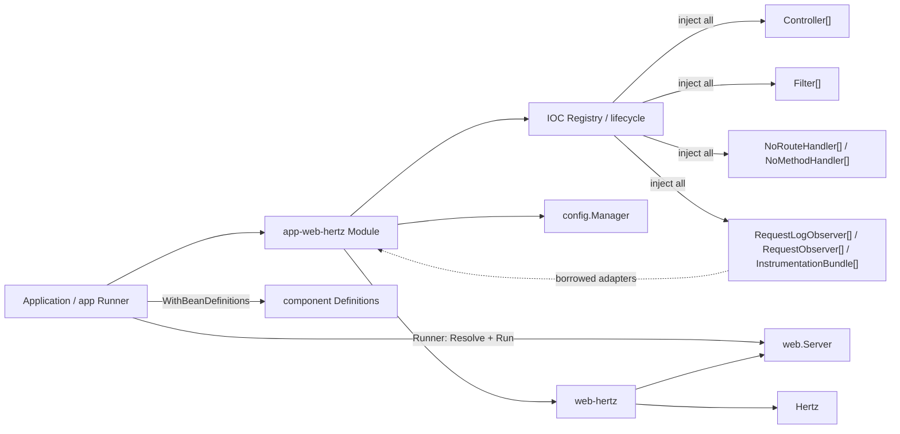
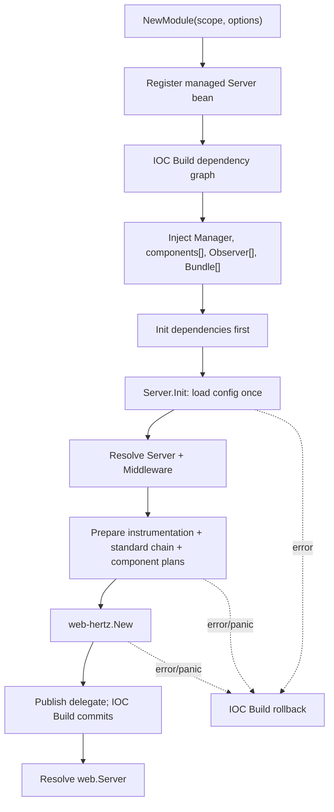

# App Web Hertz Architecture

本文描述 `app-web-hertz` 的应用模型、IOC 自动装配、依赖顺序和资源所有权。任务用法见 [使用指南](../guides/app-web-hertz-usage.md)，模块入口见 [README](../../app-web-hertz/README.md)。

## 1. 要解决的问题

`web-hertz` 只负责 Hertz 生命周期、独立配置和原生扩展。应用还需要一个稳定位置把 Controller、Filter 和 fallback handler 转换为 Middleware/Route，并在 IOC 场景中自动聚合全部组件、构造 Server、保证关闭顺序。

如果在 Container Build 完成后才 Resolve Controller/Filter 并构造 Server，Server 已无法注册回同一个 Container，生命周期只能留在容器之外。设计因此必须把 Server 作为 Build 前的依赖图节点，而不是 Build 后的临时对象。

## 2. 目标与非目标

目标：

1. 保持根 `web.Server` 只有稳定生命周期合同。
2. 保持 `web-hertz` 不知道 Controller、Filter、IOC 和配置 scope。
3. 让全部 IOC 组件进入同一个私有构造核心，避免参数、Option 与容器依赖形成多套组件入口。
4. 让 IOC 拓扑保证组件先初始化、Server 后初始化，关闭时顺序相反。
5. 保留 app-web-hertz、config、IOC 和 web-hertz 的可分支错误链。
6. 以不含 OTel 类型的原子 Bundle 接受成对 Hertz 插桩，并保持 Provider/Exporter 所有权在外部。

非目标：包扫描、隐式接口发现、自动 Run、通用 workload SPI、默认启用 Middleware、hlog 生命周期、启动配置热更新、服务注册、观测后端资源创建和信号处理。

## 3. 核心决策

### 3.1 Server 必须在 Build 前注册

约束是 IOC 只允许 created 状态注册 bean，Build 后不能追加对象。当前选择由 `NewModule` 注册一个尚未持有 provider 的托管 Server bean；IOC 注入完成后，其 `Init` 才读取配置并创建底层 Server。

结果是 Build 成功后可以按 `web.Server` 唯一解析，Container Close 也能自动停止它。未选择 Build 后二次注册，也未扩展 IOC 的状态模型。

### 3.2 IOC 适配直接属于 app-web-hertz

Controller/Filter/fallback handler 本来就是该模块的应用合同，自动聚合又只服务于这一组合同，因此 IOC Module、Definition 工厂与私有构造核心放在同一模块，不新增只有薄转发逻辑的 provider 模块。

`app-web-hertz` 直接依赖 config/ioc；纯 Hertz 或无 IOC 使用者直接使用 `web-hertz`，本模块只提供 IOC 应用组件装配。

### 3.3 Module 只声明，Init 才获取资源

`NewModule` 和 `Register` 只归一化 scope/Option 并注册 bean。Snapshot 读取、Controller 反射计划和 Hertz 构造均发生在 IOC Init。

这保持 app-runtime Module 的纯声明合同，使 Registry 失败没有外部资源需要回滚，Init 失败则由 IOC 统一回滚此前成功组件。

### 3.4 Module 不自动 Run

`Run` 是阻塞型工作负载，错误需要进入应用主流程。若 Init 偷偷启动 goroutine，Build 无法表达监听失败，应用也无法统一协调多个工作负载。

因此 Build 后由 composition root Resolve `web.Server` 并调用 `Run`。`Runner()` 只是该步骤的单 Server app 适配器；IOC 仍只负责构造和 Close。

### 3.5 hlog 属于 composition root

Hertz hlog 是进程级可变状态，不属于单个 Server bean。当前模块不安装、不恢复也不借用 Logger；composition root 在 Container Build 前安装，使路由注册日志进入目标后端，并在 Container Close 后恢复。

### 3.6 标准 Middleware 使用固定阶段和实例私有状态

约束是配置需要表达 Recovery、Request ID、Access Log、CORS、Gzip，但不能允许任意 Order 形成不可验证组合，也不能让第三方包级可变状态造成多 Server 互相污染。当前选择由 `app-web-hertz` 公开稳定 Config/typed policy，Middleware 实现保持私有且只持有当前构造快照；Recovery 复用锁定版本的 Hertz 内置实现。

固定链为 `advanced outer -> instrumentation -> Request ID -> completion Observation -> Recovery -> CORS -> Gzip -> global Filters -> grouped Filters -> Controller-local Middleware`。Access Log 由 Config 启用并要求 Request Log Observer；Metrics Observer 与 Instrumentation Bundle 由 IOC 按对象存在性启用。Log/Metrics 共享一次完成态快照，Bundle 可选提供 Trace ID 元数据。`app-web-hertz` 只聚合接口，不创建 Logger/Registry/Provider。

## 4. 依赖方向



`web-hertz` 不反向依赖 app 层；应用组件也不能反向依赖 `web.Server`，否则形成循环。

## 5. 对象与所有权

| 对象/资源 | 创建者 | 运行期所有者 | 关闭责任 |
|---|---|---|---|
| Controller/Filter/fallback handler | 应用 | IOC | IOC 按 Definition 声明处理 |
| `config.Manager` | Runtime/应用 | Runtime/应用 | Module 只借用，不关闭 |
| 托管 Server bean | `NewModule.Register` | IOC | IOC 调用 `Close` |
| `web-hertz.Server` | Server bean Init | Server bean | `Close -> Shutdown` |
| hlog / 日志 Provider | composition root | composition root | Server 停止后恢复/关闭 |
| Request Log/Metrics Observer | 可选适配模块/应用 | 适配 bean 所有者 | app-web-hertz 只借用；注册资源由适配 bean 回收 |
| Instrumentation Bundle | 可选 Trace 适配器 | 适配 bean | app-web-hertz 只借用；Bundle 不拥有 Provider |
| OTel Provider/Exporter | 应用 Provider managed bean | 应用/IOC | Server/adapter 关闭后 ForceFlush、Shutdown |

托管 bean 本身实现 `web.Server`、`ioc.Initializer` 和 `ioc.Closer`，但只向容器额外声明 `web.Server`；同一实例只执行一次 Init/Close。

## 6. 配置与声明模型

| 输入 | 默认/零值 | 归并规则 | 生效阶段 | 失败语义 |
|---|---|---|---|---|
| Module scope | 空白为 `web.hertz` | 构造时固定 | Server bean Init | `config_load_failed` |
| `webhertz.Config` | provider 默认；Router bool 为三态 | typed Config 后由原生 Option 覆盖；WithNoMethod 可达性除外 | provider 构造 | 保留 web-hertz cause |
| `appwebhertz.Config` | Server 默认 + 标准能力全关闭 | Server YAML inline；Middleware 使用子段 | Server Init | `config_invalid` / `config_load_failed` |
| Recovery / Request ID / Access Log / CORS / Gzip | enabled=false | Snapshot 配置后由 typed policy/Observer 补充策略 | 标准链构造 | 配置非法或 typed 依赖缺失 fail-fast |
| 通用 RequestObserver | 空集合 | IOC 注册顺序 | 完成态阶段 | nil fail-fast；无 YAML 总开关 |
| Instrumentation Bundle | 空集合（Trace 默认关闭） | IOC 注册顺序 | provider 构造前 | Option/Middleware 任一非法则整体 fail-fast |
| `WithRoutePathStyle` | Kebab | 后者覆盖 | Controller plan | `declaration_invalid` |
| `WithServerOptions` | 空集合 | 按声明顺序追加 | provider 构造 | nil fail-fast |
| Controller/Filter | 可为空 | IOC 注册顺序 | Build 注入 | typed nil 在 plan 阶段失败 |
| NoRoute/NoMethod Handler | 可为空 | 先按 IOC 注册顺序注入，再按 Order 稳定排序 | Build 注入 | typed nil 在 fallback plan 阶段失败 |

Module 只读取当前 Snapshot 一次且不调用 Subscribe。旧的扁平 Server 字段与新增 `router`、`middleware` 子段从同一 scope 解码；即使 Manager 后续发布新 Snapshot，已构造 Server 的地址、timeout、Middleware 和路由也不改变。

## 7. 构建事务



稳定提交点是 IOC Build 成功。Server delegate 只在 `web-hertz.New` 完整成功后写入，调用者不会看到半初始化对象。

`managedServer.Init` 把全部注入字段冻结为一个私有 `serverComponents` 快照；builder 统一处理 Controller、Filter、fallback、Observer 与 Instrumentation Bundle。Option 只描述路径风格、typed policy 和 `web-hertz` 原生扩展。

## 8. 依赖图与顺序

托管 Server bean 的依赖边：

```text
managed Server
  -> config.Manager
  -> every Controller
  -> every Filter
  -> every NoRouteHandler / NoMethodHandler
  -> every Observer / Instrumentation Bundle
```

IOC 先构图，再按拓扑顺序注入和 Init。因此应用组件若实现 `ioc.Initializer`，其初始化必然先于路由与 fallback 计划冻结。

Container Close 逆拓扑执行：

```text
Server.Close / Shutdown
-> each direct dependency Close（先后只由依赖边决定）
Instrumentation adapter Close
-> Provider owner ForceFlush / Shutdown
```

只保证 adapter 先于其 Provider owner 关闭；Filter/Controller 与 adapter 若没有互相依赖，不声明额外先后。

若 Controller 注入 `web.Server`，图同时出现 `Controller -> Server`，Build 返回 `ioc.build.circular_dependency`。这是明确拒绝的所有权倒置，不做循环降级。

## 9. Controller 与 Filter 计划

Controller 计划分三个阶段：

1. 归一化 GroupPath；空字符串和 `/` 使用同一个根逻辑分组键 `/`。
2. 若实现 RouteRegistrar，先保存手动注册入口。
3. 扫描导出方法，验证动词、签名和路径风格，保存已绑定 Handler 方法值。

路由装配先按 GroupPath 缓存框架持有的共享基础 group，并在其上一次性安装 GroupedFilter；每个 Controller 再通过 `base.Group("")` 获得无路径子分组。运行期不执行 `reflect.Call`。手动路由先注册，自动路由随后注册，使 Controller 可以先用 `router.Use` 影响自身全部路由，但不会污染同一逻辑分组的其他 Controller。

Filter 在构造期先按接口类型分类，再在各自作用域内按 `(Order, IOC/input index)` 稳定排序。普通 Filter 注册到 Engine 全局链；GroupedFilter 注册到 GroupPath 对应的基础 group，根 GroupPath 仍不是全局。请求期直接执行 `DoFilter` 方法值，不创建适配对象。

标准 Middleware 在 Filter 计划之前构造，但最终由 `web-hertz` 一次性冻结。advanced outer 来源于既有 `WithServerOptions`；Instrumentation Bundle 紧随其后，Request ID 与 Recovery 之间只安装一个完成态 Observation；全部 Filter 位于 Gzip 内层。Bundle 先完整验证 Option/Middleware，再进入构造计划。Access Log 缺少 typed Observer、CORS 缺少动态策略、Bundle 任一半非法均以 `declaration_invalid` 在 Engine 创建前失败。

## 10. 生命周期与并发

托管代理不复制 `web-hertz` 状态机：

1. `Init` 前 Run/Shutdown 返回 `server_state_invalid`，不得 panic。
2. `Init` 成功后 Run/Shutdown 原样委托底层 `web.Server`。
3. `Close` 在未取得 delegate 时为幂等 nil；正常路径委托 Shutdown。
4. Server 单运行周期、并发 Shutdown、caller 等待中断和稳定结果均由 `web-hertz` 定义。
5. Module 不创建后台 goroutine；唯一运行 goroutine由调用方选择。

独立诊断端口不改变上述 Server bean 合同。Phase 4 quickstart 在应用 composition root 创建一个 Workload
Controller，把业务 `web.Server` 与应用 owned 的诊断 `net/http.Server` 作为同级成员接入 `app` Runner 和
Shutdown Hook；`app-web-hertz` 不依赖诊断配置、Prometheus Handler 或 pprof。

如果 Run 因 context 取消已正常停止，后续 Container Close 再次 Shutdown 是幂等操作。

首次 Container Close context 必须覆盖 Server 的完整优雅停止窗口。IOC 的 Closer 等待若先超时，会按容器合同继续关闭后续 bean；因此短 deadline 不能保证 Server 后台停止期间 Controller/Filter 仍保持可用。

## 11. 错误与可观测性

| 稳定错误码 | 阶段 | 状态语义 |
|---|---|---|
| `app_web_hertz.config_invalid` | Init config resolve | 未创建 Handler/Engine，保留 provider cause |
| `app_web_hertz.config_load_failed` | Init/load config | delegate 未发布，IOC Build 失败 |
| `app_web_hertz.declaration_invalid` | Option/plan/precheck | Registry 无部分修改或 delegate 未发布 |
| `app_web_hertz.server_build_failed` | provider build | delegate 未发布，保留 provider cause |
| `app_web_hertz.module_register_failed` | Module Register | Server bean 未注册，保留 IOC cause |
| `app_web_hertz.server_state_invalid` | Run/Shutdown precheck | 未调用底层对象 |
| `app_web_hertz.server_resolve_failed` | app Runner precheck/resolve | 未调用底层对象，保留 IOC cause |

Module Init 错误外层还会包含 `ioc.build.init_failed`；依赖缺失和循环分别由 IOC 在 Init 前返回稳定错误码。错误消息携带适用的 `op/result/stage/reason/scope/index`，不得包含请求体、token、TLS 私钥或完整凭据。

本模块没有常驻 logger。内建 Recovery/Gzip 的失败诊断使用当前 Hertz hlog 并包含 `op/result/reason`；请求 access-log 与 metrics 通过注入 Observer 适配，模块自身不识别日志或 Prometheus 类型。

## 12. 可验证不变量

| 可观察合同 | 保证机制 | 合同测试 |
|---|---|---|
| 私有 builder 完整拒绝非法组件和 Option | Engine 创建前统一计划校验 | `TestBuildServerRejectsInvalidDeclarations` |
| Module 自动发布唯一 `web.Server` | Build 前声明 + 接口索引 | `TestModuleAutomaticallyAssemblesControllerFilterAndServer` |
| Definition 工厂发布语义接口 | 工厂内固定 WithDeclare + Runtime 原样注册 | `TestDefinitionFactoriesPublishApplicationSemanticInterfaces` |
| fallback handler 稳定排序且拒绝 typed nil | `(Order, registration index)` 稳定计划 | `TestPrepareFallbackHandlersSortsStablyAndRejectsTypedNil` |
| Container Close 能停止正在运行的 Server | managed bean Close 委托 Shutdown | `TestContainerCloseStopsManagedRunningServer` |
| Controller/Filter 按注册顺序注入 | IOC slice 注入 | `TestModuleAutomaticallyAssemblesControllerFilterAndServer` |
| scope trim、默认和配置错误链稳定 | Init 单次 loadConfig | `TestModuleUsesCustomScopeAndPreservesConfigFailures` |
| 旧扁平字段与 middleware 子段同源解码 | Config.Server YAML inline | `TestLoadConfigPreservesFlatScopeAndDecodesRouterConfig` |
| Go 配置值与 Snapshot 解析一致且无订阅 | 共用 resolveConfiguredConfig | `TestGoValueAndSnapshotConfigResolveIdentically` |
| 标准链顺序和 panic 最终 500 稳定 | 固定 Handler 阶段 + Recovery 外层 | `TestPrepareStandardMiddlewareKeepsFixedOrder`、`TestRecoveryProducesFinal500AndPreservesRequestID` |
| IOC 配置只读一次并产生真实请求行为 | managed Init 单次 Current + 共用 build | `TestModuleBuildsConfiguredMiddlewareFromSingleSnapshot` |
| CORS 不允许通配符凭据组合 | resolve 阶段安全校验 | `TestResolveConfiguredConfigRejectsInvalidMiddleware`、`TestCORSMiddlewareAppliesSafePreflightAndRejectsUnknownOrigin` |
| Gzip 尊重协议与内容保护条件 | 完成态基础检查 | `TestGzipMiddlewareCompressesEligibleResponseAndRespectsGuards` |
| Access Log 与 Metrics 共享最终 panic 快照 | 单 Observation + 元数据桥接 + IOC 接口切片 | `TestModuleBuildsConfiguredMiddlewareFromSingleSnapshot` |
| Access Log 配置不能被 Metrics Observer 冒充 | 独立 RequestLogObserver 语义合同 | `TestPrepareRequestObserversRequiresAdapterAndAppliesAccessLogPolicy` |
| Bundle Option/Middleware 要么同时安装、要么都不安装 | 构造前原子展开和完整校验 | `TestPrepareInstrumentationBundlesRejectsPartialDeclaration` |
| Trace ID 与 Request ID 合并到同一完成态快照 | Bundle metadata provider + bridge | `TestInstrumentationMetadataFlowsIntoCompletionObservation` |
| 缺失 Manager 在 Init 前失败 | required interface 依赖 | `TestModuleRequiresManagerAndRejectsControllerServerCycle` |
| Controller 反向依赖 Server 被拒绝 | IOC 拓扑循环检测 | `TestModuleRequiresManagerAndRejectsControllerServerCycle` |
| nil Option 不留下部分注册 | Register 前 resolveOptions | `TestModuleRejectsInvalidDeclarationsBeforeRegistryMutation` |
| Init 前生命周期调用不 panic | delegate 状态保护 | `TestManagedServerRejectsLifecycleBeforeInit` |
| 诊断端口不进入业务 Router 或 Server bean | 应用 Workload Controller + 私有 ServeMux | `TestWorkloadAssemblyExportsRealPrometheusAndStopsTogether` |
| Filter 保留 Hertz 原生链和稳定顺序 | 构造期排序 + 方法值 | `TestFilterOrderExecutesThroughNativeHertzChain` |
| 相同 GroupPath 共享分组 Filter 且 Controller Middleware 隔离 | 缓存基础 group + 无路径子分组 | `TestGroupedFiltersShareLogicalGroupWithoutLeakingControllerMiddleware`、`TestRootControllerMiddlewareDoesNotLeak` |

## 13. 容量、限制与演进

1. Build 成本随 Controller 方法数、Filter 数和路由数线性增长；请求期没有反射调用。
2. 当前按类型唯一解析 `web.Server`，不定义多 Server 的名称、Run 或关闭策略。
3. `Runner()` 只适配按类型唯一解析的单 Server；多 Server 监督仍由 composition root 的应用 Controller 显式实现。
4. 启动配置和路由计划不热更新；变化需要重建 Container/Runtime。
5. 自动路由把方法名作为公开 URL 声明，兼容性敏感接口应使用显式路由。
6. 标准 Middleware 只处理启动期静态策略；动态配置刷新需要独立原子策略合同，不能订阅整个 Config。
7. Gzip 只处理完整内存响应，不接管流式/SSE/升级连接；Access Log/Metrics 使用完成态 Observation，Trace 使用原子 Instrumentation Bundle。

## 14. File Map

1. `app-web-hertz/controller.go`、`route_registrar.go`、`filter.go`、`grouped_filter.go`、`no_*_handler.go`：应用扩展合同。
2. `app-web-hertz/route.go`、`group_path.go`、`route_path.go`、`route_path_style.go`、`filter_plan.go`：Controller/Filter 计划、逻辑分组和路径映射。
3. `app-web-hertz/configured_config.go`、`middleware_config.go`：完整 Config、默认值和校验。
4. `app-web-hertz/middleware*.go`：标准链、typed policy 与 Recovery/Request ID/CORS/Gzip 实现。
5. `app-web-hertz/request_log_observer.go`、`request_observation.go`：日志语义合同、Config 策略和完成态桥接。
6. `app-web-hertz/instrumentation_bundle.go`：无 OTel 类型的原子插桩合同。
7. `app-web-hertz/model.go`、`builder.go`、`options.go`：完整组件快照、私有构造核心和策略 Option。
8. `app-web-hertz/definition.go`：应用组件到 IOC Definition 的语义工厂。
9. `app-web-hertz/module.go`：IOC Module 和 Server bean 注册。
10. `app-web-hertz/managed_server.go`：依赖注入、Init、生命周期委托和 Close。
11. `app-web-hertz/runner.go`：app 单 Server Runner 适配。
12. `app-web-hertz/config.go`：独立 scope 配置加载。
13. `app-web-hertz/errors.go`：稳定错误码。
14. `app-web-hertz/*_test.go`：配置、Middleware、Observation、Bundle、依赖图、路由和真实生命周期测试。

## 15. 相关文档

1. [app-web-hertz README](../../app-web-hertz/README.md)
2. [使用指南](../guides/app-web-hertz-usage.md)
3. [Quickstart](../../examples/quickstart-app-web-hertz/README.md)
4. [web-hertz 架构设计](web-hertz-design.md)
5. [能力配置化与可观测性演进提案](web-hertz-capability-observability-proposal.md)
