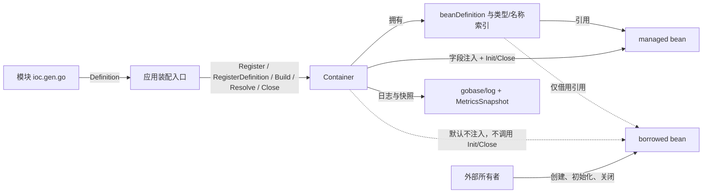
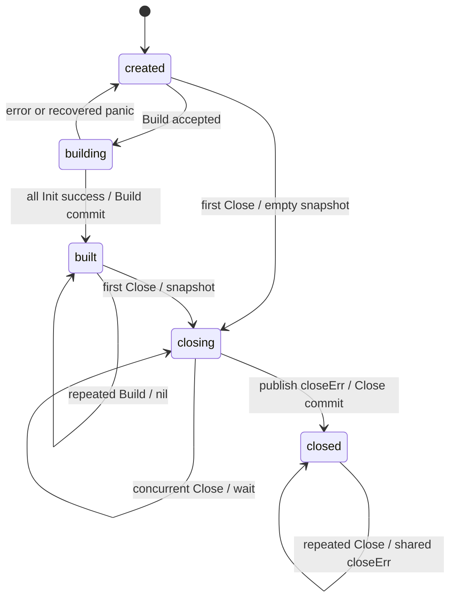
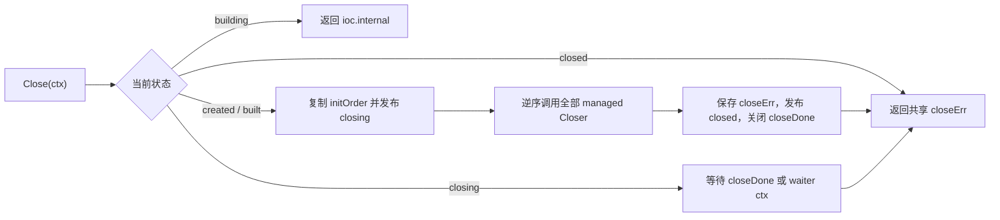

# IOC 架构设计

本文从问题、设计理由和实现机制三个层次定义 `ioc`。面向使用者的操作步骤见
[IOC 使用指南](../guides/ioc-usage.md)，最短入口见 [ioc README](../../ioc/README.md)。

## 1. 是什么：要解决的问题

应用启动时通常需要完成四件事：

1. 将已经创建的基础对象和业务对象放入同一个装配上下文。
2. 根据对象声明找到依赖，并在业务启动前完成依赖写入。
3. 保证依赖先于消费者初始化，退出时按相反顺序释放资源。
4. 在缺失依赖、候选歧义、循环依赖和初始化失败时给出可定位、可分支的结果。

如果这些逻辑全部留在 `main` 或各业务模块中，注册顺序、资源所有权和失败回滚会逐渐分散。`ioc` 的职责是把它们收敛为一个显式、一次性的应用装配阶段：

```text
Register/RegisterDefinition -> Build(ctx) -> Resolve -> Close(ctx)
```

它不是对象创建框架。`Register` 与 `RegisterDefinition` 都接收已经存在的实例，容器只负责索引、注入、排序和生命周期调用。

### 1.1 设计目标

1. **显式边界**：注册与构建由应用入口触发，不依赖包扫描或隐式副作用。
2. **确定性**：候选选择、集合顺序、Init 顺序和 Close 顺序都可解释。
3. **所有权清晰**：区分容器拥有的 managed bean 与外部拥有的 borrowed bean。
4. **失败可收敛**：Build 失败回滚已初始化资源，Close 尽量释放剩余资源。
5. **可诊断**：错误码用于程序分支，日志和指标用于定位阶段与降级原因。

### 1.2 非目标

1. 不实现 Spring IoC 的完整能力，不提供 component scan、annotation、AOP 和 scope proxy。
2. 不提供配置绑定、条件装配和自动配置发现；这些属于上层 `app-runtime` 编排。
3. 不支持 Build 成功后的动态注册、局部刷新或运行期容器重建。
4. 不通过代理解决循环依赖，也不承诺循环对象的初始化先后关系。

## 2. 为什么：核心设计选择

核心选择由“启动期一次性装配”这个约束推导，而不是为了覆盖所有 IoC 使用方式：

| 决策 | 主要约束 | 当前选择 | 对外结果 | 代价与未选择方案 |
|---|---|---|---|---|
| 装配入口 | 启动前必须发现完整对象图 | 显式 `Register/RegisterDefinition + Build` 两阶段 | Build 成功前不可 Resolve | 放弃扫描带来的少量装配代码；避免隐式发现和包初始化副作用 |
| 对象创建 | 构造依赖配置、SDK 和外部所有权 | 注册已有实例 | 容器不猜测构造函数 | 调用方负责创建；构造器/工厂模型暂未提供 |
| 依赖写入 | 已有实例需要统一建图，兼容引用环 | 受限字段注入 | 候选和字段规则确定 | 依赖不体现在构造签名中，并产生反射成本 |
| 生命周期所有权 | 基础对象可能由外层 Runtime 持有 | managed 与 borrowed 分离 | 只有 managed 进入 Init/Close | 调用方必须准确声明 borrowed，避免重复释放 |
| 循环依赖 | 引用可写不等于 Init 存在偏序 | 默认拒绝，显式弱模式降级 | 强模式确定；弱模式可观测 | 弱模式放弃依赖先初始化保证；不引入代理和两阶段构造 |
| Init 失败 | 未发布容器不能带着部分资源运行 | 首错停止、逆序回滚、返回 error | Build 保持原子发布语义 | 不支持 continue；panic 仅保留给编程异常 |
| Close 协调 | 关闭只能执行一次，但可能有并发调用者 | `closing + closeDone + closeErr` | 并发等待、重复调用共享首次结果 | 首个调用者的 context 决定执行边界；无法强杀忽略 context 的 goroutine |
| bean 名称 | 类型范围内需要稳定分流和诊断标识 | 每个 bean 一个最终名称 | `(declareType, name)` 唯一 | 不提供 alias；多个业务角色需要注册多个实例 |

### 2.1 为什么使用显式 Register/Build

显式两阶段模型把“声明对象”和“发布可用容器”分开：

1. Register 只建立名称、类型和顺序索引，不获取运行资源。
2. Build 在注册集稳定后一次性建图，可以在 Init 前发现缺失、歧义和循环。
3. 只有 Build 成功后 Resolve 才开放，调用方不会读取到半初始化对象。

代价是应用必须编写装配代码。项目通过 `app-runtime.WithBeanDefinitions/WithModules` 组织这部分代码，而不是把装配重新隐藏到扫描机制中。

### 2.2 为什么注册实例，而不是由容器自动构造

当前容器接收实例，原因是对象构造往往包含配置、第三方 SDK、测试替身和外部资源所有权。让调用方构造、容器装配，可以避免容器同时承担构造器选择、参数解析和工厂生命周期。

这也意味着：Register 阶段不应提前启动需要回滚的资源。资源获取应放在 `Initializer.Init`，否则 Build 失败时容器无法可靠判断如何释放它。

### 2.3 为什么当前选择字段注入

字段注入允许先创建全部实例，再统一建图和写入引用，适合当前“注册实例”的模型，也让对象引用环在兼容模式下具备技术上的可写入条件。

代价是依赖不体现在构造函数签名中，并依赖反射和可导出字段。为降低隐式性，容器只处理四类字段，并用明确的候选规则和 `ioc` tag 限定行为。需要字段注入的实例必须是非 nil struct 指针；值类型 struct 的字段不可写，当前实现会跳过其字段注入。

构造器/工厂注册是未来可能增加的另一种装配入口，不应通过推测构造函数或自动调用任意方法实现。

### 2.4 为什么拆分 managed 与 borrowed

容器中并非所有对象都归容器所有。例如 ConfigManager、Logger、外部 Client 可能由 `app-runtime` 或其他组件创建和关闭，但业务 bean 仍需要解析它们。

因此注册包含两个相互独立的维度：

| 维度 | Option | 决定什么 |
|---|---|---|
| 字段注入 | `WithInject(bool)` | Build 是否修改该对象的依赖字段 |
| 外部生命周期所有权 | `WithBorrowed()` | 容器是否跳过该对象的 `Init/Close` |

未指定 `WithBorrowed()` 的 bean 默认由容器管理，同时开启注入和生命周期。borrowed bean 默认关闭注入和生命周期，但仍建立索引，可被其他 bean 依赖和解析。只有调用方显式设置 `WithInject(true)`，容器才修改 borrowed 对象字段。

这个默认值遵循最小惊讶原则：借入对象通常已经由外部完成构造，容器不应在未授权时修改其内部状态。

### 2.5 为什么默认拒绝循环依赖

循环引用可以完成字段写入，但无法形成“所有依赖都已完成 Init 后再初始化消费者”的偏序关系。因此默认 Build 返回 `ioc.build.circular_dependency`，保留强生命周期语义。

`WithAllowCircularDependency(true)` 只用于兼容历史对象图：

1. 仍然先为全部对象完成字段注入。
2. 放弃拓扑 Init 顺序，改用注册顺序。
3. 记录 warning、累计指标、循环链路和实际降级顺序。

它解决的是“允许对象互相持有引用”，不是“保证循环双方启动完成”。

### 2.6 为什么 Init error 使用固定原子语义

Init 发生在应用发布前，任一失败都意味着容器不能发布为 `built`。因此 Init 返回 error 时固定执行“首错停止、逆序回滚成功项、Build 返回 error”，不再提供 stop/continue/panic 策略。

原因：

1. `Build(ctx) error` 已经把正常失败表达为 error 契约。
2. continue 可能在依赖未成功 Init 后继续初始化消费者，扩大副作用和级联错误。
3. 是否 panic、记录日志或退出进程属于应用入口策略，不属于容器生命周期策略。
4. 多错误校验应前移到无资源副作用的 config validator，而不是在 Init 阶段收集。

Initializer 意外 panic 仍视为编程异常：容器先回滚此前成功项，把 payload 归一化为 `ioc.build.init_failed`，然后继续 panic。Close 发生在退出阶段，首错不应阻止其他资源释放，因此固定继续并聚合全部失败，不提供 stop 策略。

### 2.7 为什么 bean 只有一个名称

bean name 用于日志标识、按名解析、多候选字段分流和 map key。它表达 bean 在声明类型范围内的角色，而不是脱离类型的全局身份。允许一个 bean 具有多个名称，会让配置引用、错误定位和字段分流出现多个等价入口，并重新引入 alias 的认知成本。

当前模型明确区分：

1. name 表达 bean 角色，一个 bean 只有一个最终名称；重复 `WithName` 遵循 Option 后者覆盖前者的规则。
2. declare 表达 bean 可以承担的类型契约；`WithDeclare[T]()` 可以重复调用并累积多个类型。
3. 每个声明类型都与最终名称组成 `(declareType, name)` 索引键，全部指向同一个 bean definition；同一次 Register 只执行一套注入和生命周期。
4. 名称只需在相同声明类型下唯一；不同声明类型可以复用名称，因为所有解析入口都先确定目标类型。

默认名称在 Register 阶段按以下规则确定：

1. Register 按顺序应用 Option；全部 Option 应用完成后，如果最终的 `WithName` 结果非空则优先使用，名称会先去除首尾空白。
2. 最终名称为空时，根据注册实例的具体类型生成默认名称：去掉指针、包路径和泛型参数，保留原始类型短名称与原始大小写。例如 `*mysql.Repository` 的默认名称是 `Repository`，`*cache.Cache[domain.User]` 的默认名称是 `Cache`。
3. `WithDeclare[T]()` 只增加类型索引，不参与名称推导；声明为 `Repository` 不会把 bean 名称改成 `Repository`。
4. 每个 `(declareType, name)` 必须唯一；任一声明类型下冲突时 Register 返回 `ioc.register.duplicate_name`，且不会写入该 bean 的任何索引。

泛型实例化类型按精确 `reflect.Type` 隔离，因此 `Cache[User]` 与 `Cache[Order]` 可以共享默认名称 `Cache`。如果两个名称表达不同业务角色，模型要求创建两个 bean 实例，而不是为同一实例增加 alias。面向角色的命名方法和适用场景以 [IOC 使用指南“使用稳定、面向角色的名称”](../guides/ioc-usage.md#145-使用稳定面向角色的名称) 为权威入口。

## 3. 怎么做：对象模型与依赖索引

### 3.1 核心对象

| 对象 | 阶段职责 |
|---|---|
| `Container` | 对外提供 Register/RegisterDefinition、Build、Resolve、Metrics、Close |
| `Definition` | 固化模块 Bean 与默认 RegisterOption，避免 Composition Root 重复装配细节 |
| `beanDefinition` | 固化实例、名称、声明类型、所有权和注册序号 |
| `RegisterOption` | 配置单个 bean 的唯一名称、声明类型和装配语义 |
| `Option` | 配置容器级日志、Close timeout 和循环策略 |
| `Initializer` | 在依赖注入后获取运行资源或启动服务 |
| `Closer` | 在正常关闭或失败回滚中释放资源 |



实线箭头表示调用或容器拥有的元数据关系，虚线表示不转移所有权的借用关系。容器始终拥有 bean definition 和索引，但只拥有 managed bean 的生命周期；borrowed bean 的实例所有权留在外部。`WithInject(true)` 只允许容器修改 borrowed bean 字段，不改变虚线所表达的生命周期所有权。

### 3.2 名称和类型索引

每个 bean 建立两个维度的索引：

1. 类型名称索引：为具体类型和每个额外声明类型分别建立 `(declareType, name)` 键，用于按名解析与名称冲突检查。
2. 类型候选索引：具体类型默认加入；重复 `WithDeclare[T]()` 可追加接口或其他可赋值类型，全部指向同一个 bean definition。

名称的生成、优先级和冲突规则见 2.7。`WithDeclare[T]()` 不改变 bean 名称，但会为该声明类型增加同名解析键。

`WithDeclare[Repository]()` 只声明“该实例可作为 Repository 使用”，不会创建新实例。泛型入口直接生成 Repository 的 `reflect.Type`；重复调用会累积并去重声明类型，注册时逐项验证实例确实实现或可赋值给目标类型。

### 3.3 候选选择

单值字段的候选决策固定为：

```text
0 个候选 -> required 时失败，可选时保持原值
1 个候选 -> 直接选择
多个候选 -> 在当前字段类型候选内尝试用字段名匹配 bean name
仍不唯一 -> dependency_ambiguous
```

`Resolve(target)` 与字段注入不同：它没有字段名可用于分流，因此要求目标类型只有一个候选。多候选调用方应使用 `ResolveByName`；后者使用 target 的精确声明类型和 name 共同定位 bean，不进行全局名称查找。

集合规则：

1. `[]T` 按注册顺序注入全部 T 候选。
2. `map[string]T` 注入全部 T 候选；key 固定使用 bean 在 T 声明类型范围内的最终名称。注册阶段已保证 `(T, name)` 唯一，因此不会出现同 key 覆盖。
3. `ResolveAll(&[]T)` 同样按注册顺序返回；没有候选时返回空切片，不报错。

### 3.4 字段规则

只有可写的导出字段参与注入。bean 自身需要注册为非 nil struct 指针，才能让这些字段可写；值类型 struct 可被索引和解析，但字段注入会被跳过。支持类型：

1. `interface`
2. `ptr`
3. `slice`，且元素必须是 interface 或 ptr
4. `map[string]T`，且 T 必须是 interface 或 ptr

字段 tag：

| Tag | 语义 |
|---|---|
| 无 tag | 参与注入，依赖必填 |
| `ioc:"required=false"` | 无候选时保留字段原值 |
| `ioc:"required=true"` | 显式声明必填 |
| `ioc:"-"` | 完全跳过字段 |

其他值类型字段不会被容器修改。`map` key 不是 string 时 Build 返回内部不变量错误，而不是静默转换。

## 4. Build 事务与状态机

### 4.1 状态转换



精确状态语义：

| 状态 | Register | Build | Resolve | Close |
|---|---:|---:|---:|---:|
| `created` | 允许 | 允许 | 拒绝 | 允许，关闭空清单 |
| `building` | 拒绝 | 拒绝并发 Build | 拒绝 | 拒绝并发 Close |
| `built` | 拒绝 | 幂等返回 nil | 允许 | 允许 |
| `closing` | 返回 `container.closed` | 返回 `container.closed` | 返回 `container.closed` | 等待共享结果，waiter context 可独立取消 |
| `closed` | 拒绝 | 拒绝 | 拒绝 | 返回首次 `closeErr` |

`closing` 在首个 Close 复制关闭清单后发布，表示关闭不可逆但事务尚未完成；`closed` 只在 executor 完成全部遍历并保存 `closeErr` 后发布。状态完成仍不证明忽略 context 的 Closer goroutine 已退出，因为 timeout 只能结束容器等待。

Build 失败恢复到 `created`，调用方可以补充注册或修正外部状态后重试。已经写入对象的依赖字段不会回滚；容器保证的是生命周期资源回滚，不是对象内存快照事务。

### 4.2 Build 阶段

| 阶段 | 输入与前置条件 | 主要动作 | 资源或副作用 | 失败结果 | 成功输出 |
|---|---|---|---|---|---|
| snapshot | `created`、稳定注册集 | 状态切到 `building`，复制注册顺序 | 阻断并发 Register/Build/Close | 状态检查错误；原状态不变 | bean 快照 |
| graph | bean 快照 | 收集字段依赖、建图、拓扑排序或循环降级 | 只创建内部计划 | 恢复 `created`；无生命周期资源 | 确定执行顺序 |
| inject | 确定顺序 | 依次写入允许注入的字段 | 对象字段开始产生可见修改 | 恢复 `created`；已写字段不回滚 | 完成依赖写入的对象图 |
| init | 已注入对象图 | 依次调用 managed `Initializer` | bean 可以取得连接、goroutine 等资源 | 逆序回滚成功项，恢复 `created` | 全部 managed bean 初始化成功 |
| commit | 全部 Init 成功 | 保存 Close 顺序并发布 `built` | Resolve 从此开放 | 当前实现没有可返回的提交后失败分支 | 可用容器 |

Build 的 commit point 是在锁内同时保存 `initOrder` 并把状态切换为 `built`。commit 前的 error 都不会发布可 Resolve 容器；Initializer panic 在回滚后继续抛出，外层 defer 仍把 `building` 恢复为 `created`。

依赖边的语义是“消费者依赖提供者”。拓扑遍历先访问依赖，因此正常模式下提供者先 Init，消费者后 Init。注册序号用于稳定同级节点顺序，避免无依赖节点随机抖动。

borrowed bean 仍可以成为图中的依赖节点；容器只跳过它自身的 Init/Close。borrowed bean 默认不注入字段，因此默认没有从它出发的字段依赖边。

### 4.3 Init 失败与异常

Init 返回 error：

1. 停止后续 Init。
2. 逆序 Close 此前成功 Init 的 bean。
3. 回滚错误与原始错误通过 `errors.Join` 聚合。
4. Build 返回 `ioc.build.init_failed`，容器恢复为 `created`。

Init 意外 panic：

1. 停止后续 Init。
2. 执行同样的逆序回滚。
3. 将 panic payload 作为 cause 包装为 `ioc.build.init_failed`。
4. 记录结构化错误并继续 panic；Build 外层 defer 恢复容器状态和失败指标。

失败或 panic 的 Initializer 本身不进入“已成功初始化”清单，必须在返回/抛出前自行清理半初始化资源。回滚 Close 使用传给 Build 的同一个 context；该 context 已取消时，Closer 仍需正确处理取消并返回可聚合错误。回滚固定遍历全部已成功初始化项并聚合错误，与正常 Close 共享完整收敛原则。

### 4.4 Build 失败矩阵

| 阶段/原因 | 对外结果 | 失败后状态 | 回滚或残留 | 能否重试 |
|---|---|---|---|---|
| 容器已 `closed` | `ioc.container.closed` | `closed` | 无动作 | 同一容器不能 |
| 另一个 Build 正在执行 | `ioc.internal` | `building`，由首个调用继续推进 | 当前调用无动作 | 首个 Build 结束后按最终状态决定 |
| 依赖缺失或歧义 | 对应 `ioc.build.*` error | `created` | 尚未注入、无生命周期资源 | 修正注册后可以 |
| 默认模式发现循环 | `ioc.build.circular_dependency` | `created` | 尚未注入、无生命周期资源 | 拆环或显式降级后可以 |
| 字段写入阶段失败 | 对应 Build error | `created` | 之前已写字段不恢复 | 仅在对象允许重复写入时谨慎重试 |
| Initializer 返回 error | `ioc.build.init_failed`，保留 cause | `created` | 逆序 Close 成功 Init 项；回滚错误通过 `errors.Join` 聚合 | 外部状态和对象允许时可以 |
| Initializer panic | 回滚后 panic `ioc.build.init_failed` | defer 恢复为 `created` | 与 error 路径相同；失败 Initializer 自清理半成品 | 捕获 panic 后仍需先判断对象是否可重用 |

## 5. Close 与资源所有权

### 5.1 所有权与关闭顺序

Build 成功后，容器保存完整拓扑/降级顺序。Close 逆序遍历该顺序，只调用同时满足以下条件的对象：

1. `managedLifecycle=true`
2. 实现 `Closer`

因此提供者通常晚于消费者关闭。borrowed bean 不会被关闭；外部所有者必须在合适的更外层阶段释放它。

### 5.2 Close 共享事务

Close 使用一个 executor 和任意数量 waiter 协调一次性资源事务：



首个调用者成为 executor，其 context 控制实际 Close；`closing` 在复制关闭清单后发布，阻止新的 Register/Build/Resolve。并发调用者成为 waiter，在共享 `closeDone` 与自己的 context 之间等待：事务先完成则返回共享 `closeErr`，waiter context 先结束则返回 `ioc.close.failed/reason=wait_canceled`，但不改变 executor 和共享结果。

Close 固定继续遍历全部 Closer，不提供 stop 策略：

1. 每个 error、timeout 和被恢复的 panic 都转换为 `ioc.close.failed`。
2. 全部失败最终使用 `errors.Join` 聚合，随后一次性发布 `closeErr` 和 `closed`。
3. `WithCloseTimeout(d)` 为每个 bean 单独创建 timeout context；executor context 与单 bean timeout 共同限制等待时间。
4. `closed` 上的重复 Close 直接返回首次 `closeErr`，不会用后续 nil 覆盖失败。

调用方 context 取消或单 bean timeout 都只能让容器停止等待并返回错误，Go 无法强制终止 `Closer.Close` 所在 goroutine。Closer 必须监听 context 并自行退出，否则仍可能留下后台工作。

Closer panic 在执行 goroutine 内恢复，记录 stack 并转换为 `ioc.close.failed/reason=close_panic`；容器继续关闭剩余资源并增加 `ClosePanicTotal`。这保证关闭结果和 waiter 可以收敛，但 panic 仍属于必须修复的编程异常。

### 5.3 Close 失败与并发矩阵

| 场景 | 当前调用结果 | 容器状态 | 资源结果 | 后续 Close |
|---|---|---|---|---|
| `created` 上首次 Close | `nil` | `closing -> closed` | 关闭清单为空；已注册但未 Build 的对象不会被关闭 | 返回共享 nil |
| `built` 上首次 Close 全部成功 | `nil` | `closing -> closed` | managed Closer 全部逆序完成 | 返回共享 nil |
| 一个或多个 Closer 返回 error | 聚合 `ioc.close.failed` | `closing -> closed` | 仍尝试全部剩余 Closer | 返回同一个共享 error |
| executor context 取消或 timeout | 聚合 `ioc.close.failed` | `closing -> closed` | 仍遍历剩余 Closer；不响应 context 的 goroutine 可能遗留 | 返回同一个共享 error |
| Closer panic | 聚合 `ioc.close.failed` | `closing -> closed` | panic 节点计为失败，继续剩余 Closer | 返回同一个共享 error |
| Close 正在执行时并发 Close | 等待共享结果 | `closing` | 不重复调用 Closer | 完成后返回共享结果 |
| waiter context 先结束 | 独立 `wait_canceled` | 保持 `closing` | executor 不受影响 | 稍后重复 Close 可读取共享结果 |
| Build 正在执行时 Close | `ioc.internal` | `building` | 不执行关闭 | Build 结束后可重新调用 |

因此 Close 的幂等语义同时包含“底层 Closer 至多执行一次”和“所有正常完成的调用者观察同一首次结果”。waiter context 只控制等待，不拥有共享事务。

## 6. 循环依赖的精确语义

默认模式：

```text
A -> B -> A
       |
       +-> Build 返回 ioc.build.circular_dependency
           chain=A -> B -> A
```

兼容模式：

```text
按注册顺序确定降级 order
  -> 按 order 为全部 bean 注入字段
  -> 按 order 调用 managed Init
  -> Close 时逆 order
```

允许循环依赖不会改变以下规则：

1. 缺失依赖仍然失败。
2. 多候选歧义仍然失败。
3. borrowed 默认仍不注入、不管理生命周期。
4. Init error 仍固定首错停止并回滚；意外 panic 仍回滚后继续 panic。

适合开启的场景仅限双方在 Init 时不要求对方已经完成 Init 的引用环。涉及连接建立、服务监听、后台任务就绪等启动前置条件时必须拆环。

## 7. 并发和上下文语义

1. 容器使用锁保护状态、名称索引和类型索引；Metrics 使用原子计数和快照复制。
2. Build 的建图、反射注入和 Init 在状态切换后于锁外执行，避免长时间持有容器锁。
3. `Build(nil)` 和 `Close(nil)` 回退到 `context.Background()`。
4. Build 不在建图和字段注入阶段主动检查 context；它只把同一个 context 同步传入每个 Initializer。Initializer 忽略取消时，容器无法中断它，Build 仍可能继续等待或成功。
5. Close 为每个 Closer 启动 goroutine，并在“Closer 返回”和“context 结束”之间选择；单 bean timeout 会在调用方 context 上再派生子 context。取消只结束容器等待，不保证 Closer 已退出。
6. executor context 结束后，容器仍遍历剩余 Closer；它们会收到已取消的 context，不响应 context 的实现可能继续形成遗留 goroutine。
7. 并发 Build 返回错误；并发 Close 不启动第二个事务，而是等待首个 executor 发布结果。waiter context 只控制自身等待。
8. `closeErr` 在关闭 `closeDone` 前写入，并与 `closed` 一起受锁保护；channel close 和锁共同保证 waiter 读取结果的 happens-before。
9. 容器提供状态竞争保护，但推荐的使用模型仍是阶段化单写：启动注册、单次 Build、运行期只读解析、退出阶段共享一次 Close。

## 8. 错误与可观测性

### 8.1 错误码

| ErrorCode | 语义 |
|---|---|
| `ioc.internal` | 状态冲突或容器内部不变量失败 |
| `ioc.container.closed` | closing/closed 容器仍被 Register、Build 或 Resolve；closing 使用 `reason=close_running` |
| `ioc.container.not_built` | Build 成功前尝试解析 |
| `ioc.register.invalid_bean` | bean 为空或无法建立名称 |
| `ioc.register.duplicate_name` | 同一声明类型下 bean 名称冲突 |
| `ioc.register.invalid_declare` | 声明类型非法或实例不满足声明 |
| `ioc.build.dependency_not_found` | 必填依赖没有候选 |
| `ioc.build.dependency_ambiguous` | 单值依赖存在多个候选且无法按字段名分流 |
| `ioc.build.circular_dependency` | 依赖图存在环且未开启降级 |
| `ioc.build.init_failed` | Init 或 Build 回滚失败 |
| `ioc.resolve.invalid_target` | Resolve 输出目标形态不合法 |
| `ioc.resolve.not_found` | 指定类型或名称不存在 |
| `ioc.resolve.ambiguous` | Resolve 类型存在多个候选 |
| `ioc.close.failed` | Close 失败、取消或超时 |

错误消息补充 `op/result/stage/reason` 和 bean/field/type/chain 等上下文。按错误码分支应使用 `errcode.IsCode`，它会遍历包装链和聚合错误；`errors.As` 用于提取特定错误类型及其上下文，在存在多层同类型错误或 `errors.Join` 时不替代任意内层错误码匹配。文本字段只用于日志检索和人工诊断。

### 8.2 日志和指标

未提供 logger 时，容器使用 `gobase/log` 默认 logger。关键路径记录：

1. Register 成功或失败。
2. Build 开始、成功、失败或循环降级。
3. Close 开始、成功和聚合失败。

关键日志使用 `op/result` 标识操作和结果，失败或分支事件补充 `stage/reason`；bean、field、type、chain、order 等字段只记录诊断上下文，不应包含凭据或业务敏感值。

`Metrics()` 返回进程内累计快照，计数不自动清零：

| 字段 | 计数口径 |
|---|---|
| `RegisterTotal` | 成功发布到索引的 bean 数量；注册失败不增加 |
| `BuildTotal` | 每次 Build 调用，包括 already-built 跳过、状态拒绝、成功和失败 |
| `BuildFailedTotal` | Build 状态拒绝、主流程 error 或 Initializer panic；already-built 跳过不算失败 |
| `BuildCircularRejectedTotal` | 默认模式下每次拒绝循环对象图增加一次 |
| `BuildCircularDegradedTotal` | 弱模式下每次按注册顺序完成降级增加一次 |
| `InitFailedTotal` | 每个失败或 panic 的 Initializer 增加一次 |
| `CloseTotal` | 从 `created/built` 接受的 Close executor 数；waiter、`closed` 重复调用和 `building` 拒绝不增加 |
| `CloseJoinedTotal` | 在 `closing` 状态加入共享事务的并发 waiter 数 |
| `CloseWaitCanceledTotal` | waiter 因自身 context 结束返回 `wait_canceled` 的次数，不影响共享事务 |
| `CloseFailedTotal` | 每个返回 error、取消或 timeout 的 Closer 调用增加一次；包含 Build 回滚和正常 Close，不是失败事务数 |
| `CloseTimeoutTotal` | 启用 `WithCloseTimeout` 后，单 bean 等待命中 DeadlineExceeded 的次数 |
| `ClosePanicTotal` | Closer panic 被恢复并转换为 `close_panic` 的次数 |
| `LastCircularDegrade` | 最近一次循环降级的 chain、实际 order 和时间；新记录覆盖旧记录 |

各累计字段使用原子读取，`LastCircularDegrade` 使用锁并在返回时复制，因此单字段并发安全；整个 `MetricsSnapshot` 不是跨字段事务快照，Build/Close 并发推进时相邻字段可能来自略有差异的时刻。

## 9. 边界不变量

1. Resolve 只在 Build 成功后开放，不返回半构建对象。
2. Build 正常模式下依赖先 Init，Close 时消费者先关闭。
3. borrowed 不由容器调用 Init/Close，除非重新以 managed 语义注册为另一个 bean；不建议这样做。
4. `WithInject(true)` 只授权字段写入，不转移生命周期所有权。
5. 循环降级必须可观测，不能静默改变初始化顺序。
6. Build 失败必须恢复可重试状态，并回滚已成功 Init 的资源。
7. 未成功 Build 的注册对象不进入正常 Close 清单。
8. Init 正常失败只通过 Build error 暴露，是否 panic 由应用入口决定。
9. Build 回滚和正常 Close 都固定继续关闭全部目标项，不允许首错停止破坏资源收敛。
10. 底层 Closer 至多由容器执行一次；并发和重复 Close 共享首次 `closeErr`。
11. waiter context 只取消自身等待，不改变 executor context、状态或共享结果。
12. `closed` 表示关闭遍历及结果发布完成，不证明忽略 context 的生命周期 goroutine 已退出。

关键不变量由以下契约测试直接覆盖：

| 不变量 | 当前测试 |
|---|---|
| Build 后才允许 Resolve，状态拒绝可分支 | `TestUseCaseBuildAndResolveStateGuard` |
| 依赖先 Init、消费者先 Close | `TestUseCaseInitAndCloseOrder`、`TestUseCaseCloseUsesReverseInitOrder` |
| borrowed 默认不注入且不执行生命周期 | `TestUseCaseBorrowedBeanSkipsManagedLifecycle` |
| Init error/panic 逆序回滚 | `TestUseCaseInitFailureStopsAndRollsBack`、`TestUseCaseInitPanicRollsBackAndRepanics` |
| rollback error 与原错误聚合 | `TestUseCaseInitFailureAggregatesRollbackError` |
| 循环默认拒绝、弱模式可观测 | `TestUseCaseCircularDependency`、`TestUseCaseMetricsObserveCircularDegrade` |
| Close 固定继续并聚合、timeout、context 传递 | `TestUseCaseCloseAlwaysContinuesAndAggregates`、`TestUseCaseCloseTimeout`、`TestUseCaseCloseUseContext` |
| 并发/重复 Close 共享首次结果 | `TestUseCaseConcurrentCloseSharesFirstResult` |
| waiter context 只取消自身等待 | `TestUseCaseCloseWaiterContextOnlyCancelsWaiting` |
| Closer panic 转为共享错误并继续 | `TestUseCaseClosePanicBecomesSharedErrorAndContinues` |

## 10. 备选方案与取舍

### 自动扫描

减少装配代码，但引入包初始化副作用、发现范围和测试隔离问题。当前选择显式注册，并由上层 Bean Definitions/Modules 组织装配。

### 默认允许循环依赖

可以提高兼容性，但会把不确定的 Init 顺序变成常规语义。当前选择默认拒绝，只提供显式弱约束模式。

### borrowed 默认注入

使用更省配置，但容器会修改不属于自己的对象。当前选择默认不注入，需要 `WithInject(true)` 明确授权。

### 可配置 Close stop/continue

stop 会因为一个资源失败而永久跳过其他资源释放，并让调用方误以为之后可以重试补偿。当前删除整个 `CloseFailurePolicy`，固定继续遍历并聚合错误；依赖逆序已经表达关闭顺序，不再增加破坏完整收敛的策略分支。

### 可配置 Init stop/continue/panic

表面上提供更多控制，但 continue 会在依赖未就绪时继续产生副作用，panic 又属于应用入口决策。当前删除整个 InitFailurePolicy，只保留固定的原子 error 语义。

## 11. 容量与性能边界

现有基准计时范围包含容器创建、注册和对应 Build/Close，不只测单个内部函数。它们用于发现数量级变化，不构成跨硬件 SLA。2026-08-09 本地 Windows/amd64、Intel i7-7700K 三轮样本结果：

1. 1000 个无注入 bean 的创建、注册和 Build：约 `0.92ms/op`、`867KB/op`。
2. 10 个 repository 加 1000 个 consumer 的创建、注册、反射注入和 Build：约 `7.00-7.40ms/op`、`3.63MB/op`。
3. 10 个阻塞 closer、单个 2ms timeout：约 `153-155ms/op`。

从仓库根目录复现：

```powershell
& ./scripts/go.ps1 -C ioc test -run '^$' -bench . -benchmem
```

容量模型：

1. Register 成本主要随声明类型数量增长；Build 建图和拓扑排序随 bean、可注入字段、候选检查和依赖边总量增长，其中 DFS 为 `O(bean + edge)`。
2. 字段依赖收集和实际注入都会使用反射；字段和集合候选越多，分配及扫描成本越高。
3. Close 严格串行以保持逆依赖顺序。若有 `L` 个都忽略 context 的 Closer 且单 bean timeout 为 `d`，只考虑单 bean timeout 时等待上界接近 `L*d`，还会遗留最多 `L` 个 goroutine；调用方更短的总 deadline 可以提前结束等待，但不能终止 goroutine。
4. 现有基准只覆盖到 1000 bean。超过该规模不是禁止使用，而是未形成容量证据；应在预期规模和至少 2 倍规模分别执行 benchmark，并以应用启动、内存和 shutdown deadline 作为验收线。
5. 大量 Closer 不能通过并行化简单优化，因为依赖顺序本身是正确性约束。优先让每个 Closer 快速、幂等并响应 context，再用外层 shutdown deadline 和单 bean timeout 限制等待。

## 12. Open Gaps / Future Improvements

1. 构造器/工厂注册模型尚未定义，需要先明确对象创建失败和所有权转移语义。
2. Build 失败只回滚生命周期资源，不回滚已经写入的字段值。
3. Close timeout 无法终止忽略 context 的业务 goroutine。
4. 当前循环链从错误文本提取到指标，后续可升级为结构化错误字段。
5. 尚未提供依赖图导出和启动诊断视图。
6. 值类型 struct 的字段注入会被静默跳过，尚未提供不可写 bean 的 fail-fast 校验。

## 13. File Map

1. `ioc/container.go`：`Container` 契约、注册索引、状态机和 Resolve/Close 入口。
2. `ioc/definition.go`：模块 Bean 与默认注册策略的原子装配对象。
3. `ioc/options.go`：bean 名称、声明类型、注入和所有权选项。
4. `ioc/container_option.go`：日志、Close timeout 和循环策略。
5. `ioc/model.go`：bean 定义、共享 Close 和指标模型。
6. `ioc/inject.go`：字段规则、候选选择、集合注入和依赖收集。
7. `ioc/lifecycle.go`：依赖图、拓扑排序、循环降级、Init 和回滚。
8. `ioc/generic.go`：强类型 Resolve 辅助。
9. `ioc/errors.go`：ErrorCode 和统一错误构造。
10. `ioc/definition_test.go`：Definition 声明发布、选项隔离和非法输入测试。
11. `ioc/usecase_test.go`：状态、注入、所有权、循环、Init 回滚和共享 Close 事务测试。
12. `ioc/generic_injection_test.go`：真实泛型类型的默认名称、注入、解析和冲突测试。
13. `ioc/benchmark_test.go`：大规模对象图和 timeout 开销基准。
14. `examples/quickstart-ioc/`：strict、allow-circular 和生产化运行示例。

## 14. 相关文档

1. [ioc README](../../ioc/README.md)
2. [IOC 使用指南](../guides/ioc-usage.md)
3. [quickstart-app](../../examples/quickstart-app/README.md)
