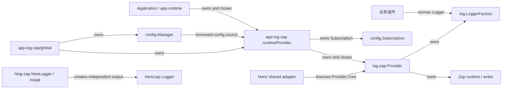

# Log 架构设计

本文描述 `log`、`log-zap`、`app-log-zap`、`app-log-zap/global` 与 `hlog-zap` 组成的日志子系统。重点是稳定业务契约、模块依赖、资源所有权、运行期更新和失败后仍然成立的语义；配置步骤与业务示例以 [Log 使用指南](../guides/log-usage.md) 为准。

## 1. 原始问题与约束

业务日志必须同时满足两组经常冲突的要求：业务代码需要小而稳定的记录接口，宿主和框架又需要编码、轮转、动态级别、配置订阅与全局适配能力。如果把 Zap、`slog.Logger`、配置来源或宿主生命周期直接暴露给业务，任一实现变化都会扩散；如果把所有能力塞进根门面，接口又会被特定 provider 和框架语义污染。

当前设计受以下约束：

1. 业务只依赖跨 provider 稳定的 Logger、Level 和 Field，不依赖 Zap 类型。
2. Provider 必须能够独立创建、使用和关闭，不能要求 app-runtime 或 ConfigManager 存在。
3. 配置来源由宿主选择；日志核心不能隐式创建、订阅或关闭外部 Manager。
4. 已创建 Logger 必须跟随动态 level 和 Provider 关闭状态，不要求重新获取实例。
5. caller、字段优先级、脱敏和 envelope 保护必须在所有根 Logger 出口保持一致。
6. Hertz 必须满足既有 `hlog.FullLogger` SPI，但其格式化和 Fatal 语义不能反向扩散到根业务契约。

### 设计目标

1. 根包唯一实现业务 Logger，并通过标准 `slog.Handler` SPI 接入 provider。
2. Provider 对外稳定持有 LoggerFactory，对内独占编码、输出和关闭资源。
3. 配置订阅、应用装配和全局初始化位于显式适配层。
4. 完整启动配置与可原子热更新的窄配置分离。
5. 缺失 provider 时仍有可见、确定且不持有外部资源的降级输出。
6. 关键边界具有可分支错误码，并能通过契约测试验证。

### 非目标

1. 根 `log` 契约不暴露 Zap 类型，也不重新定义 Handler、Record、Value 或编码协议。
2. 根 `log` 契约不提供静态 LoggerFactory、全局 provider 发现、goroutine-local MDC 或字符串 context key 扫描。
3. 日志子系统不提供可靠投递、写入确认或业务事务语义。
4. 根 `log.Logger` 不提供 Fatal、进程退出、格式化级别镜像方法或依据参数类型自动判级；`hlog-zap` 仅为满足 Hertz SPI 保留其格式化和 Fatal 行为。
5. 运行期更新不重建输出拓扑；mode、format、caller 和 rotate 变化需要重新创建 Provider。

## 2. 关键设计决策

### 2.1 业务依赖小接口，slog 只作为内部事件模型

约束是业务契约需要长期稳定，同时 provider 作者需要成熟的事件、属性和 Handler 组合模型。当前选择由根包定义 `Logger/Level/Field`，私有实现构造 `slog.Record`，只把 `slog.Handler` 暴露为 provider SPI。

这样做的对外结果是：业务不依赖 `*slog.Logger` 或 Zap，provider 也不重复实现 Logger 命名、caller 和字段策略。代价是根接口不会自动获得 slog 后续新增的便捷方法；确需纯文本格式化时由调用方显式使用 `fmt.Sprintf`，高成本 Debug 内容先用 `Enabled` 判断。

没有直接暴露 `*slog.Logger`，因为它会把 `slog.Attr`、级别和派生方法一并固化为业务合同；也没有重新定义 Handler/Record，因为标准 SPI 已能表达 provider 接入需求。

### 2.2 Provider 拥有日志核心，适配层拥有配置来源

日志核心必须能够脱离 app-runtime 独立运行，而 ConfigManager 的创建、订阅和关闭责任取决于宿主。当前选择是：

- `log-zap.Provider` 独占 Factory、Zap runtime、AtomicLevel、writer、Sync 和 Close；
- `app-log-zap` 借用调用方 Manager，独占 Subscription，并把 Subscription 与纯 Provider 组合成一个 `log.Provider`；
- `app-log-zap/global` 才同时拥有 Manager 和组合 Provider。

因此纯 Provider 不依赖配置模块，传入的 Manager 也不会被适配器越权关闭。代价是动态配置需要额外适配层，但资源所有权和失败回滚保持明确。

没有让 `log-zap.Provider` 直接持有 Manager 或通用 watcher option，因为配置拓扑不是普通构造策略；允许普通 option 替换配置来源会使构造器名称、更新来源和关闭责任失真。

### 2.3 完整启动配置与窄运行期配置分离

level 可以通过共享 AtomicLevel 原子更新，不需要替换 encoder 或 writer；mode、format、caller 和 rotate 会改变输出资源或事件结构。当前选择用 `log-zap.Config` 创建核心，只允许宿主通过 `RuntimeConfig` 推送 level。

非法运行期 level 在修改 AtomicLevel 前返回错误，既有 level 保持不变；空 level 表示 no-op；Provider 关闭后的更新返回 nil 且不会重新激活核心。代价是非 level 配置只能通过重建 Provider 生效，这是资源安全边界而不是暂时的 option 限制。

### 2.4 字段策略在 provider 之前统一

caller、context 字段、脱敏、envelope 和重复键如果由各 provider 分别处理，会产生无法统一检索和审计的事件。当前选择由根 LoggerFactory 组合 schema、Redactor 和 ContextExtractor Handler，再把 canonical `slog.Record` 交给 provider。

因此标准降级与 Zap Provider 共享同一字段规则。代价是直接借用 `Provider.Core()` 的框架日志不会经过根 LoggerFactory 策略；这种路径必须由框架适配层单独约束，不能假设自动获得 ContextExtractor、Redactor 或 schema 保护。

### 2.5 Provider.Core 是借用视图，不是第二个所有者

Hertz 等框架需要 Zap Core 才能复用现有生态，但不能因此取得 writer 和 Close 权限。`Provider.Core()` 返回稳定动态视图：每次调用读取 Provider 当前 runtime，共享 level、encoder、writer 和关闭状态；其 `Sync` 为 no-op，也不提供 Close。

Provider Close 后，已有 Core 保持可调用但不再输出。该选择避免双重 Sync/Close，代价是借用方必须保证 Provider 生命周期覆盖框架 Host，并接受根字段策略不适用于直接 Core 写入。

## 3. 子系统边界与所有权



箭头标签同时限定依赖与资源责任：

1. Business 只借用 Logger，不关闭 Factory 或 Provider。
2. 组合 Provider 借用 Manager；它取消自己的 Subscription，但不关闭 Manager。
3. Application/runtime 是普通组合 Provider 的最终所有者；global 场景由 global 同时拥有 Manager 和 Provider。
4. Hertz shared adapter 借用动态 Core，不执行 Sync/Close；独立 `NewLogger/Install` 不共享根 Provider。
5. 所有权只沿图中的 `owns` 箭头转移，普通调用或数据流不会隐式转移资源。

## 4. 根事件契约与字段不变量

`Logger` 只表达 `Enabled/Log/Debug/Info/Warn/Error/With`，context 始终是首参数。`Level` 只定义 Debug、Info、Warn、Error 四种跨 provider 严重程度；Zap 配置中的 trace 映射到 Debug，不扩展根级别模型。

`Field` 仅包含 `Key/Value`。`F/Err/Group` 提供最小构造入口，`Op/Result/Reason` 提供统一检索键；Result 接受 string，并提供 ok/failed/degraded/skipped/running 标准值。message 是稳定的人类可读描述，机器检索维度和错误对象进入 Field；Redactor 不扫描 message。

`LoggerFactory.Get(name)` 统一 trim、空值到 root 的归一化和固定 `logger` 字段。Factory 不缓存命名 Logger，同名只保证行为一致，不保证实例身份；name 必须保持低基数。

同层字段按以下来源顺序进入 schema，标量冲突采用 first-wins：

| 优先级 | 字段来源 | 作用域 |
|---|---|---|
| 1 | Factory/Get 固定字段 | logger 生命周期 |
| 2 | `Logger.With` 字段 | 派生 Logger 生命周期 |
| 3 | 单次日志调用 Field | 当前事件 |
| 4 | ContextExtractor | 当前已启用事件 |

同层同名 Group 按声明顺序合并，再对子字段应用相同 first-wins 规则。顶层 `ts/level/msg/caller/func/name/stacktrace` 是 envelope 保留键，业务同名字段被丢弃；`logger` 由 Factory 固定字段和优先级规则保护。

`With` 立即固化字段结构并返回不修改父对象的 Logger，但 `Field.Value` 中的引用值不深复制，后续可变性仍由调用方负责。

Provider 缺失时，`NewLoggerFactory(nil)` 使用 INFO、stderr、text、source enabled 的标准 fallback。Fallback 不持有外部资源，但仍经过根字段策略。

## 5. 事件流水线与 Zap Provider

```text
Logger method
  -> normalize nil context
  -> Handler.Enabled
  -> capture caller PC
  -> Field -> slog.Attr
  -> slog.Record
  -> optional ContextExtractor
  -> optional Redactor
  -> schema normalization
  -> provider Handler
```

禁用事件不捕获 caller、不转换 Field，也不执行 ContextExtractor 或事件级 Redactor。`With` 字段在派生阶段转换并脱敏一次。Handler 装饰顺序保证 ContextExtractor 字段也会经过 Redactor 和 schema。

Zap Handler 每次事件读取 Provider 当前 runtime，并按以下顺序写入：

1. 把 slog level 映射为 Zap Debug/Info/Warn/Error。
2. 通过 `Core.Check` 执行 level、sampling 和 hook 判定。
3. Check 通过后才合并固定 Attr、WithGroup 和 Record Attr，并转换为 Zap 强类型字段。
4. error 使用 `zap.NamedError`，Group 使用 ObjectMarshaler。
5. `Record.PC` 映射为 `zapcore.EntryCaller`。
6. 使用 `CheckedEntry.Write` 写入，保留 Zap Core 的采样和 hook 语义。

纯 Provider 的配置和生命周期语义如下：

1. `Config` 负责 level、mode、format、disableCaller 和 rotate；字段默认值与使用方式以模块 README 和 Guide 为准。
2. `ApplyRuntimeConfig` 当前只更新 level，并立即影响已有 Logger 和借用 Core。
3. Provider Close 先发布 closed 并原子摘除 runtime，再 Sync、关闭 writer；旧 Logger/Core 随即 disabled/no-op。
4. Close 的资源副作用可重复调用，但纯 Provider 不缓存第一次 Close error；后续或并发调用者不能依赖获得相同错误，也不能依赖等待另一调用者完成资源关闭。

## 6. app-log-zap 构建与生命周期

`app-log-zap` 与 `app-runtime` 没有模块依赖。`Bootstrap.Build(ctx, manager)` 通过 Go 结构化接口满足 Logging 契约；`WithProviderOptions` 只转发 ContextExtractor 和 Redactor 等静态 Provider 策略，不承载配置来源。

`NewProviderFromManager` 的 commit point 是 Zap 核心创建成功、Subscription 与核心被封装进组合 Provider并即将返回的时刻。commit 前失败必须回滚已取得资源；commit 后由返回 Provider 独占关闭责任。

| 阶段 | 输入与前置条件 | 主要动作 | 资源与所有权 | 失败结果 | 成功输出 |
|---|---|---|---|---|---|
| normalize | Manager、scope、options | 归一化空 scope | 无 | 无独立失败 | 确定配置路径 |
| subscribe | 已发布首个 Snapshot 的 Manager | 注册 typed Subscription，并同步回放当前完整 Config | 取得 Subscription，Manager 仍为 borrowed | 返回 subscribe error，无 Provider | 初始配置和活动 Subscription |
| build core | 初始回放已完成 | 在通知串行锁内创建纯 Zap Provider | 暂时同时持有 Subscription 和核心 | 取消 Subscription，返回 core build error | 与最新回放版本一致的核心 |
| commit | Subscription 和核心均有效 | 构造组合 Provider并转移所有权 | 组合 Provider 独占两项资源 | 此后无可恢复构建分支 | 可交付 `log.Provider` |
| runtime update | 新 Snapshot 已发布 | 只投递 `RuntimeConfig{Level}` | 不替换核心或 writer | 通知返回错误，旧 level 保留 | 已有 Logger 使用新 level |
| close | 调用方停止业务写入 | 取消 context watcher 和 Subscription，再关闭核心 | 不关闭 borrowed Manager | 缓存核心 Close error | 终态 Provider |

初始回放、核心创建和后续通知由 `runtimeConfigBridge` 的锁串行，避免 `Current()` 与 Subscribe 之间的重复读取和丢失更新。刷新发生在核心创建期间时，通知会等待；核心提交后再按运行期窄配置处理。

Build context 只控制 Subscription 生命周期：取消不会关闭日志核心，也不能中断已经进入的同步 Subscribe 或核心创建。context 已取消时仍可能先完成构建，再由取消 goroutine 停止 Subscription；核心最终必须由 Provider Close 确定性释放。

组合 Provider 使用 `sync.Once` 收口 Close。并发和重复调用会等待同一次关闭事务并观察缓存结果；关闭顺序始终是 Subscription → Zap Core，传入 Manager 由其原所有者关闭。在 app-runtime 中，系统关闭顺序为：

```text
IOC close -> log provider close -> config manager close
```

该顺序保证业务组件关闭期间仍能记录日志，并让 Subscription 在 Manager 存活时完成取消。

## 7. global 与 Hertz 适配边界

### 7.1 app-log-zap/global

global 是零配置便利入口，在包初始化阶段独占创建 ConfigManager 和组合 Provider，公开 `Get/Logger/Provider/Close`。初始化不能向调用方返回 error，因此采用可观测降级链：

1. 正常路径：创建 Manager，再创建组合 Provider。
2. Manager 或组合 Provider 失败：使用标准库日志输出 `op/result/reason`，已创建 Manager 在降级前关闭。
3. 第一层降级：创建使用默认配置的纯 Zap Provider，不再持有 Manager。
4. 若纯 Provider 仍不可用：`Get/Logger` 使用根 fallback Factory，`Provider()` 返回 nil。

global Close 只执行一次，按组合 Provider → Manager 顺序关闭并聚合错误；即使关闭失败也清空资源引用，重复调用返回首次缓存结果。global 是应用边界便利能力，调用方必须在业务和框架停止使用全局 Logger 后再 Close；当前不保证 `Get/Logger/Provider` 与 Close 并发安全。

需要 ContextExtractor、Redactor 或显式生命周期时，应使用 Provider 或 app-runtime 装配，而不是 global。

### 7.2 hlog-zap

| 入口 | 底层资源 | 所有权 | 动态 level | 字段策略 | 关闭边界 |
|---|---|---|---|---|---|
| `NewFromProvider` | 借用 `Provider.Core()` | Provider 仍是唯一所有者 | `SetLevel` 更新共享 Provider | 不经过根 ContextExtractor/Redactor/schema | 先停 Hertz Host，再关 Provider |
| `NewLogger` | 独立 hertzzap Logger | 调用方持有返回 Logger | 独立 AtomicLevel | 使用 Hertz/Zap 格式化语义 | 可 Sync；文件 closer 当前未暴露 |
| `Install` | 与 NewLogger 相同，并写入 hlog 全局状态 | 应用入口负责调用时序 | 独立 AtomicLevel | 使用 Hertz/Zap 格式化语义 | 必须在并发启动前安装 |

共享路径中 `SetOutput` 是 no-op，避免 Hertz 绕过 Provider 替换 writer；Trace 映射 Debug，Notice 映射 Warn。Fatal/Fatalf 因 Hertz SPI 保留 Zap 终止进程语义，它们不属于根 `log.Logger` 合同。

## 8. 失败、错误与可观测性

| 阶段 | 失败原因 | 对外错误 | 失败后状态 | 回滚或清理 | 能否重试 |
|---|---|---|---|---|---|
| log-zap build | 配置非法或输出资源无法创建 | `log.*` 稳定错误码 | 无 Provider | 不交付半初始化对象 | 修正输入或环境后可以 |
| app-log-zap subscribe | Manager 无效、关闭或初始解码失败 | `app_log_zap.provider.subscribe_failed`，保留 config cause | 无组合 Provider | Manager 仍由调用方拥有 | 条件恢复后可以 |
| app-log-zap core build | 初始 Zap 配置非法 | `app_log_zap.provider.core_build_failed`，保留 log-zap cause | 无组合 Provider | 取消已取得 Subscription | 修正配置后可以 |
| runtime config | 新 level 非法 | `app_log_zap.provider.runtime_config_apply_failed` | Manager 新 Snapshot 已发布；Provider 保留旧 level | 不重建、不关闭核心 | 后续合法版本可以恢复 |
| pure Provider close | Sync 或 writer Close 失败 | 保留下游错误，可由 `errors.Is` 分支 | Provider 已进入终态，旧 Logger no-op | 已摘除 runtime，不重新激活 | 不能靠重复 Close 重试同一资源 |
| composite close | 核心 Close 失败 | `app_log_zap.provider.close_failed` | 组合 Provider 终态 | Subscription 已取消，错误被缓存 | 重复调用返回缓存结果 |
| global bootstrap | Manager/组合 Provider 创建失败 | init 无返回值；标准日志输出降级原因 | 尝试纯 Provider 或根 fallback | 关闭已取得 Manager | 仅能由下次进程初始化重试 |
| global close | Provider 或 Manager Close 失败 | `app_log_zap.global.close_failed` | global 引用已清空 | 聚合两类关闭错误 | 重复调用返回缓存结果 |

Provider 构建和 Close 是业务可见错误边界；单次 Logger 写入不返回错误，也不提供可靠投递确认。适配错误使用 `app_log_zap.*` 标记 bootstrap、subscribe、core build、runtime config 和 close 阶段，并保留下游 cause；调用方可用 `errcode.IsCode` 同时识别适配阶段与根因。

关键业务事件使用 `Op/Result`，失败或分支事件增加稳定 `Reason` 与 `Err`。错误和日志消息包含可检索的 `op/result/stage/scope/reason`，但不得记录 token、密码、完整凭据或未经审查的敏感载荷。

## 9. 并发、容量与安全边界

1. Logger、Factory.Get、Handler 派生、Zap runtime 读取和 AtomicLevel 更新支持并发。
2. ContextExtractor、Redactor 和自定义 Handler 必须并发安全；根包不会为调用方状态额外串行化。
3. Factory 不缓存 Logger，但 logger name 仍进入索引维度，必须保持稳定低基数。
4. `Field.Value` 的引用对象由调用方管理；记录期间并发修改会产生调用方数据竞争或不稳定输出。
5. Redactor 是结构化字段的统一防线，不扫描 message，也不能替代“不主动记录秘密”的原则。敏感值不得拼入 message。
6. 借用 `Provider.Core()` 的框架路径绕过根 Redactor；框架适配层必须独立审查其日志参数。
7. 纯 Provider Close 与写入并发时，关闭会先使新事件 no-op；调用方仍应先停止生产日志，再 Close，以避免在途写入与底层 writer 释放竞争。
8. global 初始化和关闭是应用边界操作，不应与业务 Get/Logger 调用并发。

## 10. 可验证不变量

| 不变量 | 主要契约测试 |
|---|---|
| 同名 Logger 行为一致但不承诺实例身份，fallback 永不返回 nil | `log/factory_test.go` |
| 禁用级别不执行 Field 转换、ContextExtractor 或事件级 Redactor | `log/slog_logger_test.go`、`log/policy_handler_test.go` |
| `With` 不修改父 Logger，引用值不深复制 | `log/slog_logger_test.go` |
| caller 指向业务调用点，字段优先级和 envelope 保护稳定 | `log/slog_logger_test.go`、`log/policy_handler_test.go` |
| Zap Handler 保留结构、error、Group、sampling 和 slog Handler 合同 | `log-zap/provider_test.go` |
| RuntimeConfig 只更新既有核心 level，非法值不污染旧状态 | `log-zap/provider_test.go` |
| 借用 Core 共享 level/关闭状态，Sync 不取得资源所有权 | `log-zap/core_test.go` |
| app-log-zap 初始回放不丢更新，失败取消 Subscription，context 不提前关闭核心 | `app-log-zap/bootstrap_test.go` |
| global 独占 Manager/Provider、按层降级并缓存 Close 结果 | `app-log-zap/global/global_test.go` |
| hlog 共享路径复用 writer/level/关闭状态并保持 caller 边界 | `hlog-zap/provider_test.go` |

这些测试约束的是可观察语义而非对象实例或内部函数拆分；重构实现时不得用“测试仍能编译”替代对上述结果的验证。

## 11. Open Gaps

1. 单次日志写入没有业务可见错误、缓冲确认或可靠投递语义。
2. 纯 `log-zap.Provider.Close` 不等待并发关闭事务，也不缓存首次错误；需要稳定幂等结果时由组合生命周期包装。
3. 运行期只支持 level 热更新，输出拓扑变化需要重建 Provider。
4. `hlog-zap.NewLogger/Install` 的文件模式没有暴露 lumberjack closer，无法提供完整资源释放合同。
5. global API 不提供并发 Get/Close 协调，也不支持重新初始化；它只适用于单次进程级启动与关闭。
6. 借用 Core 的框架日志不经过根字段 schema 和脱敏策略，需要适配模块单独约束。

## 12. File Map

### 根契约与字段策略

- `log/logger.go`、`level.go`、`field.go`：业务 Logger、级别与字段合同。
- `log/factory.go`、`slog_logger.go`：Factory、私有 slog Logger、命名与 caller。
- `log/context_handler.go`、`fallback_handler.go`：context 字段和标准降级出口。
- `log/redactor.go`、`redacting_handler.go`、`schema_handler.go`：脱敏、envelope 与重复键规则。
- `log/provider.go`、`semantic_field.go`：Provider 生命周期边界与 op/result/reason schema。

### Zap Provider

- `log-zap/handler.go`：slog Record 到 Zap Core 的映射。
- `log-zap/core.go`：框架适配层借用的动态 Core。
- `log-zap/provider.go`：runtime、ApplyRuntimeConfig、Sync 和 Close。
- `log-zap/config.go`、`provider_options.go`：启动/运行配置与静态策略。
- `log-zap/zap_builder.go`、`errors.go`：encoder、writer、轮转与稳定错误码。

### 配置与宿主适配

- `app-log-zap/bootstrap.go`：scope、Provider options 与结构化 Build 契约。
- `app-log-zap/provider.go`：Subscription、配置桥接、commit 和组合生命周期。
- `app-log-zap/errors.go`：适配层错误码与 cause 包装。
- `app-log-zap/global/api.go`、`runtime.go`、`errors.go`：全局入口、降级和资源所有权。
- `hlog-zap/install.go`、`config.go`：独立 Hertz Logger 构建、安装与配置适配。
- `hlog-zap/provider.go`、`errors.go`：共享 Provider 的借用 FullLogger 与边界错误。

## 13. 相关文档

1. [Log 使用指南](../guides/log-usage.md)
2. [log 模块入口](../../log/README.md)
3. [log-zap 模块入口](../../log-zap/README.md)
4. [app-log-zap 模块入口](../../app-log-zap/README.md)
5. [hlog-zap 模块入口](../../hlog-zap/README.md)
6. [App Runtime 架构设计](app-runtime-design.md)
