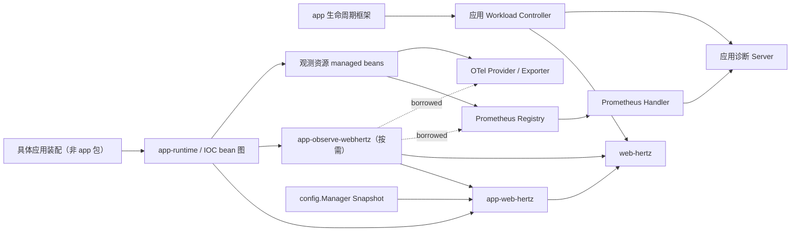
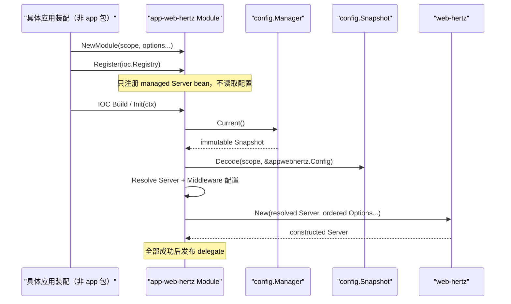

# web-hertz 能力配置化与可观测性演进提案

> 状态：实施中。Phase 0～3 已于 2026-08-24 完成，Phase 4～5 已于 2026-10-09 完成，Phase 6 按真实调用方需求评估。本文定义目标边界、推荐合同和实施顺序；当前真实行为仍以
> [web-hertz 架构设计](web-hertz-design.md)、[app-web-hertz 架构设计](app-web-hertz-design.md)
> 及对应代码和测试为准。

## 1. 决策摘要

本提案选择“`web-hertz` 原生能力 + `app-web-hertz` 配置/IOC 装配 + 按需
`app-observe-webhertz` 信号适配”三层结构；诊断 HTTP Server 由应用 workload controller 拥有，不属于
观测适配包。`app` 只负责通用 Runner/Shutdown/Runtime Close 编排，不识别 Hertz、Registry、Provider、
Exporter 或诊断 Server。该边界避免把 Hertz 全部 Option、hertz-contrib Middleware、Prometheus Server 和
OpenTelemetry Provider 一并塞进 `web-hertz.Config`。

1. `web-hertz` 继续只拥有 Hertz Engine、单运行周期和稳定 Server/Router 配置；新增的配置必须是
   可序列化、无外部资源所有权、能够直接映射 Hertz Option 的稳定字段。
2. `app-web-hertz` 负责从 `config.Manager` 读取扩展配置，按固定阶段装配 Recovery、Request ID、
   CORS、Gzip 和完成态访问观测，并继续把 Controller/Filter 转换为 Hertz 原生能力。
3. `web-hertz` 增加完成态 Request Observation/Observer 等无 Prometheus/OTel 依赖的窄合同，并继续提供
   原生 Hertz Option/Middleware 入口；`app-web-hertz` 根据配置、IOC 组件和 typed 策略 Option 装配；
   `app-observe-webhertz` 按需提供 Request Log、Prometheus 和 OTel 具体适配。
4. Prometheus、pprof 等运维端点推荐使用独立诊断监听；它不是“管理系统”，也不预设通用 Module。
   应用 workload controller 统一监督业务 Server 与诊断 Server；IOC managed bean 图逆序关闭
   registration、Provider 和 Exporter。
5. Prometheus HTTP 指标使用完成态 Middleware/Observer，不使用 Hertz `tracer.Tracer`。Hertz Tracer
   仅用于确实需要内部阶段事件或 OTel Hertz 插桩的场景。
6. `NoRoute`、`NoMethod` 通过窄 `webhertz.Option` 暴露，不增加可取得 `*server.Hertz` 的通用
   Configurer，也不破坏现有生命周期隔离。

目标优先级是：语义正确和资源可释放高于开关数量，有限基数高于采集便利，默认关闭高于隐式暴露，
可选依赖高于基础模块依赖膨胀。

## 2. 原始问题与约束

### 2.1 要解决的问题

实施前 provider 已提供 typed Config、原生 Hertz Option、Middleware 和 RouteFunc，但常用生产能力仍需
每个应用重复装配：

1. Hertz Server/Router 的安全边界未完整进入 typed Config，例如 `MaxHeaderBytes`、Write Timeout 和
   405 处理开关。
2. Recovery、Request ID、CORS、Gzip、Access Log 只能通过代码声明，无法由同一启动配置显式启用。
3. `NoRoute`、`NoMethod` 属于 Engine 能力，当前只接收 RouterGroup 的 RouteFunc 无法表达。
4. 请求日志、Prometheus Metrics、OTel Trace 容易被混称为 “tracer”，资源所有权和观测语义不清晰。
5. pprof、metrics 若直接挂到业务端口，会扩大生产暴露面；若在构造函数中隐藏启动端口，又无法统一
   观察失败和完成 Shutdown。

### 2.2 必须保持的约束

1. `web-hertz` 不读取固定配置 scope，不依赖 IOC、Prometheus、OTel exporter 或具体 hertz-contrib
   能力包。
2. `Server` 继续独占 Engine，不公开 `Run/Spin/Shutdown/Close` 旁路。
3. 启动配置只在构造阶段冻结，不承诺 Middleware、Router、监听地址或 exporter 热更新。
4. 所有新增能力默认不改变当前行为；新增开关必须显式启用。
5. 配置只能描述意图。Listener、Tracer、Registry、Provider、Secret、回调和 Handler 等对象由对应
   managed bean/adapter 创建或借用；纯策略通过 typed Option 注入，应用组件通过 IOC 注入。
6. 请求体、Authorization、Cookie、Token、Secret、SQL 参数和完整第三方响应不得进入默认日志、
   Metrics Label 或 Trace Attribute。

## 3. 模块级设计推导

### 3.1 配置描述意图，资源由运行时拥有

生产 Web 服务通常同时需要连接预算、请求上限、404/405、Recovery、Request ID、CORS、Gzip、访问日志、
Metrics、Trace 和诊断路由。高频不等于应进入同一个 Config；归属由“谁解释语义、谁创建资源、谁负责关闭”
决定：

1. 直接映射 Hertz 构造参数的纯数据归 `web-hertz`。
2. 依赖应用 Filter/Controller 顺序、但不创建外部资源的标准 Middleware 归 `app-web-hertz`。
3. Access Log、Metrics 和 Trace 复用 `web-hertz` 的 Observation/原生扩展合同；Registry、Exporter、
   Provider 和具体后端适配对象由对应 managed bean/module 提供，`app` 不感知其具体类型。
4. Listener、Registry Client、Prometheus Registry、OTel Provider 和 Secret 不在配置解码过程中创建。
5. 构造函数不得向全局 mux/registry 注册，不得启动隐藏 goroutine，也不得使用 panic/Fatal 代替可返回错误。
6. 进程全局编码器、Tracer 或日志器不由单个 Server 重置，保证多 Server 和并行测试隔离。

因此配置开关的作用是选择已声明的稳定策略，不是把对象构造、后台任务和生命周期藏到 Config 内部。

### 3.2 请求完成态与诊断端点必须独立建模

HTTP 请求指标需要最终 Route、Status、Duration 和分类后的 Result，应在 Middleware `Next` 返回后形成不可变
Observation，而不是借用 Hertz 内部 Tracer 事件模拟业务请求结果：

1. `app-web-hertz` 固定 Request ID、完成态 Observation、Recovery 与应用 Filter 的相对顺序。
2. 核心链只依赖窄 Request Observer，不知道 Prometheus、日志实现或 exporter。
3. Prometheus 使用调用方私有 Registry；未知 label 值 fail-closed，未匹配 URL 不进入 route label。
4. Metrics Handler 与诊断 Server 分离，诊断 Server 具有显式 Run/Shutdown，并与业务 Server 一起监督。
5. 日志、Metrics、Trace 各自表达不同信号，不互相替代；所有输出使用稳定、有限且不含敏感数据的字段。
6. `route_id`、`topic_id`、`contract_digest` 等领域字段不进入通用 HTTP 合同，只能由应用 Enricher 提供。

## 4. 目标模块与依赖边界



图中实线表示声明、调用或数据依赖，虚线明确表示 borrowed，不表示所有权自动转移：

1. `app` 只调用 Workload Controller 的 Run/Shutdown 合同，不知道其成员是业务 Hertz 还是诊断 Server。
2. `app-runtime` 构建并逆序关闭 IOC bean 图；具体应用装配只声明 Module/bean，不手工逐个 Close。
3. `web-hertz` Server bean owned Hertz Engine；Workload Controller 借用 Server 并负责主动 Run/Shutdown 收敛。
4. Registry、OTel Provider/Exporter 分别由创建它们的 managed bean owned；`app-observe-webhertz` borrowed
   这些资源，只 owned Collector registration。Trace Bundle 不注册 callback、不持有关闭资源，Provider owner
   在依赖它的 Server/adapter 关闭后负责 ForceFlush/Shutdown。
5. 诊断 Server 由 Workload Controller owned；Prometheus Handler 只是 borrowed Handler，不拥有 listener。
6. `app-observe-webhertz` 产出的 RequestObserver/Instrumentation Bundle 由 `app-web-hertz` 在 Server 构造期
   borrowed，失败回滚和正常注销由适配 bean 图负责。

本文中的“具体应用 composition root”仅指 `main`/业务模块声明等装配位置，不是 `app` 包。它决定启用哪些
Module 和依赖关系，但资源实例与 Close 责任应下沉到 managed bean 或 Workload Controller。

禁止的反向依赖：

```text
web-hertz -X-> app-web-hertz / Prometheus / OTel / config.Manager
app-web-hertz -X-> app-observe-webhertz / Prometheus Registry / OTel exporter / Secret Provider
app-observe-webhertz -X-> config.Manager / 固定配置 scope / 具体业务 Controller / Registry Client / Secret Provider
HTTP request observer -X-> Hertz pooled RequestContext after request completion
```

## 5. 配置所有权与目标模型

### 5.1 web-hertz Config

只有满足以下全部条件的字段才进入 `webhertz.Config`：

1. 直接映射 Hertz `config.Option`；
2. 纯数据且可稳定校验；
3. 不创建 goroutine、Listener、Client、Registry、Provider 或 Secret；
4. 不引入可选第三方依赖；
5. 构造后不需要独立 Close。

建议分批吸收：

| 配置组 | 字段 | 推荐阶段 | 说明 |
|---|---|---|---|
| Server | `WriteTimeout`、`KeepAliveTimeout` | P1 | 补全连接预算；不得静默改变当前默认值 |
| Limits | `MaxHeaderBytes`、`MaxKeepBodySize`、`ReadBufferSize` | P0/P1 | Header 上限优先；零值可能有 Hertz 特殊语义 |
| Router | `RedirectTrailingSlash`、`RedirectFixedPath`、`HandleMethodNotAllowed` | P0 | 使用 Optional Bool 区分未配置与 false |
| Path | `UseRawPath`、`RemoveExtraSlash`、`UnescapePathValues`、`BasePath` | P1 | 组合校验并补充路由兼容测试 |
| Request | `KeepAlive`、`StreamRequestBody`、`DisablePreParseMultipartForm` | P1 | Stream 与 multipart 组合必须显式说明 |
| Response | `DisableHeaderNamesNormalizing`、`DisableDefaultDate`、`DisableDefaultContentType` | P2 | 主要服务代理/特殊协议场景 |
| Debug | `DisablePrintRoute`、`GetOnly` | P0/P2 | `DisablePrintRoute` 优先，GetOnly 保留高级用途 |
| Protocol | `Network`、`H2C`、`ALPN` | P2 | ALPN 必须与 TLS/协议实现组合校验 |
| Trace | `TraceLevel` | P2 | 只控制 Hertz 内部事件级别，不创建 Tracer |

以下输入继续只走原生 Option 或独立模块：Listener、ListenConfig、TLS Config、Transport、Tracer、
Registry、OnAccept/OnConnect、Custom Binder/Validator 和协议 Factory。

布尔默认值不能使用普通 bool 的零值回填模型。`RedirectTrailingSlash`、`KeepAlive`、
`UnescapePathValues` 的 Hertz 默认值为 true，必须使用 `*bool` 或仓库统一 Optional 值表达三态。
`MaxKeepBodySize=0` 具有明确语义，也不能被统一当成“使用默认值”。

### 5.2 app-web-hertz Config 与 config.Manager

#### 5.2.1 协作合同

`app-web-hertz` 不建立第二套配置中心，也不让 `web-hertz` 依赖 `config`。IOC 路径继续以调用方注册的
`config.Manager` 为唯一事实源：



1. `NewModule("")` 继续把空 scope 归一化为 `web.hertz`；自定义 dotted scope 的行为不变。
2. `Register` 只保存 scope/Option 并注册 bean，不读取 Snapshot、不创建 Middleware、不启动 goroutine。
3. `managedServer.Init` 调用一次 `Manager.Current()`，再调用 `Snapshot.Decode`；scope 缺失、类型错误或非法组合
   使 IOC Build fail-fast，并保留 config 与 app-web-hertz 两层错误码。
4. 成功解码后分别执行 `webhertz.ResolveConfig` 和 `resolveMiddlewareConfig`，最后从同一配置版本构造完整链。
5. Server 构造成功才发布 delegate；任一步失败都不留下半初始化 Server 或配置订阅。
6. `config.Manager` 是 borrowed 依赖，`managedServer.Close` 只关闭 Server，不关闭 Manager。

#### 5.2.2 兼容配置模型

新增公开 `appwebhertz.Config` 作为应用装配输入。它把 `webhertz.Config` 以内联方式保留在顶层，并增加
`middleware` 子段，因此现有 `web.hertz.address/readTimeout/...` 无需迁移：

```go
// Config 定义 app-web-hertz 单个运行周期的 Server 与标准 Middleware 装配意图。
type Config struct {
	// Server 保留 web-hertz 的独立启动合同；YAML 解码时内联以兼容现有扁平字段。
	Server webhertz.Config `yaml:",inline"`
	// Middleware 描述模块内建 Middleware；各能力默认关闭，不持有 Handler 或外部资源。
	Middleware MiddlewareConfig `yaml:"middleware"`
}
```

目标配置示例：

```yaml
web:
  hertz:
    address: ":8080"
    readTimeout: 5s
    idleTimeout: 60s
    maxHeaderBytes: 1048576
    maxRequestBodySize: 8388608

    router:
      redirectTrailingSlash: false
      redirectFixedPath: false
      handleMethodNotAllowed: true
      disablePrintRoute: true

    middleware:
      recovery:
        enabled: true
      requestId:
        enabled: true
        header: X-Request-ID
      accessLog:
        enabled: true
        skipPaths: [/healthz, /readyz]
      cors:
        enabled: true
        allowOrigins: ["https://example.com"]
        allowMethods: [GET, POST, PUT, DELETE]
      gzip:
        enabled: true
```

`Snapshot.Decode` 的目标由当前 `webhertz.Config` 改为 `appwebhertz.Config`，但 Server 子结构最终仍交给
`web-hertz` 校验和构造。`config` 只负责 snapshot、scope 和类型解码，不知道 Hertz 或 Middleware 语义。

#### 5.2.3 配置字段与对象扩展的边界

| 能力 | YAML 负责 | typed 策略 Option / IOC 组件负责 | 非法配置结果 |
|---|---|---|---|
| Recovery | enabled、内建响应策略 | 自定义 Recovery Handler、错误上报器 | Init fail-fast |
| Request ID | enabled、header、是否信任合法入站值 | 自定义 Generator | Init fail-fast |
| Access Log | enabled、skipPaths、慢请求阈值 | IOC Request Log Observer；字段 Enricher、输出/编码/级别仍归 `log` | Init fail-fast |
| CORS | enabled、静态 origins/methods/headers、credentials | 动态 Origin Func | Init fail-fast |
| Gzip | enabled、level、minLength、静态排除类型 | 自定义压缩判断 | Init fail-fast |
| Application Filter | 不进入 YAML | IOC `[]Filter` 与 `Order()` | 声明非法时 Build 失败 |

配置 Handler 只能选择模块提供的稳定策略；任意回调、Generator、动态 Origin Func 通过 typed Option 注入，
业务组件通过 IOC 注入，不能把函数名写入 YAML 后反射解析。若配置启用某能力但所选策略要求的 typed
依赖缺失，Init 返回 `app_web_hertz.declaration_invalid`，不得静默降级。

#### 5.2.4 IOC 构造与热更新

应用装配入口是 `NewModule`；`managedServer.Init` 把 Controller、Filter、fallback、Observer 和
Instrumentation Bundle 等 IOC 组件冻结为私有快照后调用统一 builder。无 IOC 场景直接使用
`web-hertz.New`。

Server 配置和 Middleware 链均为启动配置：Init 成功后冻结，不调用 `Manager.Subscribe`。刷新后的 Snapshot
只供下一次 Build/进程重启使用。若未来确有动态 CORS 白名单等需求，应单独定义原子策略快照和失败时保留
last-known-good 的合同，不能把整个 `appwebhertz.Config` 直接热更新。

#### 5.2.5 默认值、优先级与重复启用

1. 所有新增 Middleware 的 `enabled` 默认 false，保证旧配置运行行为不变。
2. 模块默认值低于 Snapshot 配置；typed app-web-hertz Option 可替换内建策略；原生 Hertz Option 继续只
   覆盖 provider 参数或加入高级 Middleware 阶段。
3. 配置启用的标准 Middleware 只安装一次。调用方若还通过 `WithServerOptions(WithMiddleware(...))` 安装
   同类能力，框架无法可靠识别语义重复；应关闭配置开关并完全使用显式声明。
4. 配置不提供任意 `order`。标准链位置由模块合同固定，IOC Filter 继续只在 application Filters 阶段按
   `Order()` 排序。

### 5.3 信号适配与诊断 Server 不定义固定 scope

Access Log 的 `enabled/skipPaths` 决定请求 Middleware 是否安装以及哪些请求进入日志，因此归
`web.hertz.middleware.accessLog`。Logger sink、encoder、level 和输出目标继续归根 `log` 配置；
`app-web-hertz` 只依赖窄 Request Log Observer，不创建或修改全局 Logger。

不新增通用 `observability` scope。Metrics/Tracing 需要的 Registry、Meter/TracerProvider、Exporter、
Secret 和采样策略均由应用运行环境拥有，框架无法仅凭 YAML 正确取得并关闭这些资源。
`app-observe-webhertz` 只作为按需依赖的 Web 信号适配包，接入路径固定为：

1. `web-hertz` 定义完成态 Observation/Observer 与原生 Hertz Option/Middleware 能力，不依赖具体后端；
2. `app-web-hertz` 从 Config 解析标准链，并通过 IOC 接受 Observer 或原子 Instrumentation Bundle，
   把它们安装到固定阶段；typed Option 只承载纯策略和 provider 高级扩展；
3. `app-observe-webhertz` 接受调用方提供的 Prometheus Registerer/Gatherer、Logger Factory、
   Meter/TracerProvider 和 typed Options，返回 Observer、Collector、Handler、Registration 或原子 Bundle；
4. Registry/Provider managed bean 创建并拥有资源，适配 bean 通过 IOC 借用，再把适配结果交给
   `app-web-hertz`；
5. 调用方若需要配置化，可在自己的 service scope 定义配置 VO，再映射为 typed Options；该 VO 不是
   框架公共配置合同；
6. 适配包不依赖 `config.Manager`、不选择 scope、不创建 Registry/Provider、不启动 HTTP Server 或
   goroutine，也不修改全局 hlog/DefaultRegistry。

启用语义不使用一个虚假的总开关：

| 能力 | 启用条件 | 依赖缺失语义 |
|---|---|---|
| Access Log | `web.hertz.middleware.accessLog.enabled=true`，并由 IOC 提供 Request Log Observer | Init fail-fast，不静默丢日志 |
| Prometheus HTTP Metrics | 声明适配 Module/bean，由 IOC 创建并注入 Prometheus Observer | 未注入即未启用，不需要 YAML false |
| OTel HTTP Trace | 声明适配 Module/bean，由 IOC 创建并注入原子 Instrumentation Bundle | 未注入即未启用；Bundle 构造失败不发布 Server |

因此 `app-observe-webhertz` 是具体、可选的 Hertz 信号适配模块，不是全局 Observability Runtime。应用只用
Access Log 时不需要创建 Registry/Provider；只用 Prometheus 时也不需要创建 OTel Provider。

同理，本提案不定义固定 `management` scope。“诊断 Server”仅指一个与业务端口隔离的 HTTP 工作负载，
用于暴露 `/metrics` 和按需启用的 `/debug/pprof/*`。它的地址、路径和鉴权属于具体应用/部署配置；出现第二个
可复用调用方并验证生命周期合同后，再评估独立 `app-diagnostics-http` 模块。

### 5.4 默认值、优先级和生效阶段

配置优先级：

```text
web-hertz / app-web-hertz 固化默认值
  < config Snapshot 解码得到的 appwebhertz.Config
  < 调用方显式 appwebhertz typed policy Option
  < webhertz 原生 Option（仅影响 provider 参数或高级 Middleware 阶段）
```

Middleware 不使用“覆盖”语义，而使用固定阶段：

```text
advanced outer Middleware
-> OTel Server Middleware
-> Request ID
-> completion observation（access log + metrics fan-out）
-> Recovery
-> CORS
-> Gzip
-> application Filters（保持现有 Order）
-> Routes / NoRoute / NoMethod
```

`advanced outer Middleware` 是现有显式 `WithServerOptions(WithMiddleware(...))` 的兼容位置。调用方若需
改变标准能力的相对顺序，应关闭对应配置能力并用显式 Middleware 重新声明；配置中不提供任意整数
Order，避免形成不可验证的组合空间。

所有配置均在 IOC Init/Server 构造阶段读取一次。运行中刷新 Snapshot 不修改现有 Server、Middleware、
Router、Registry、Provider 或管理端点；变化需要重建 Runtime。

## 6. 特殊 Hertz 能力

### 6.1 NoRoute 与 NoMethod

新增窄公共入口：

```go
func WithNoRoute(handlers ...app.HandlerFunc) Option
func WithNoMethod(handlers ...app.HandlerFunc) Option
```

合同：

1. nil Handler 在 `New` 前 fail-fast。
2. Handler 保持声明顺序，并与全局 Middleware 组成 Hertz 原生 404/405 链。
3. `WithNoMethod` 自动追加最终优先级的 `WithHandleMethodNotAllowed(true)`，保证声明后可达。
4. 多次声明采用追加还是替换必须在实现前二选一；推荐追加后一次性调用 Engine，便于组合多个声明。
5. Config 只能启用默认 JSON/Text 错误策略；业务动态路由等自定义 Handler 继续走 typed Option。

不增加 `WithEngine(func(*server.Hertz))` 或 `Engine()` Getter，因为它们会同时暴露生命周期入口。

### 6.2 pprof、健康检查和管理路由

pprof 可通过接收 `*route.RouterGroup` 的 RouteFunc 注册，不需要暴露 Engine。目标方案仍不把它默认挂到
业务 Router，而是由诊断 Workload Builder 注册到独立诊断 Server，并满足：

1. 默认关闭；
2. 默认只绑定 loopback；
3. 使用独立 ServeMux/Router，不使用进程全局 mux；
4. 可与 Metrics Handler 共享诊断 listener 和 Shutdown；
5. 生产访问控制交给 NetworkPolicy、sidecar 或显式鉴权 Middleware。

`/healthz` 可以提供无依赖的进程存活响应；`/readyz` 必须注入 Readiness Checker，不能仅靠配置声称
ready；`/version`、contract digest 等身份字段属于应用配置，不进入 provider。

### 6.3 其他窄扩展候选

只有出现 RouteFunc/Hertz Option 无法表达的真实需求时，才依次评估：

1. `WithClientIPFunc`：可信代理和客户端 IP 解析；
2. `WithContinueHandler`：`Expect: 100-continue` 上传策略；
3. `WithPanicHandler`：Engine 最底层 panic 处理，常规请求仍优先 Recovery Middleware；
4. HTML Template/Renderer 配置；
5. 只读 `Address/Ready/Routes` 查询。

OnRun/OnShutdown 暂不直接透传。Hertz OnShutdown callback 不返回 error，无法满足 gobase 的错误聚合和
失败分支要求；服务注册也必须先定义独立的注册、回滚、注销和所有权合同。

## 7. 请求完成态观测合同

### 7.1 Observation 快照

Prometheus 和 Access Log 共享一次完成态计时，但不共享输出实现。推荐快照至少包含：

```go
// HTTPRequestObservation 是单次 HTTP 请求结束后复制出的不可变完成态快照。
type HTTPRequestObservation struct {
	// RequestID 是请求关联标识；仅用于日志/Trace 关联，不得作为默认 Metrics Label。
	RequestID string
	// TraceID 是当前有效 Span 标识；无有效 Span 时为空，不得作为默认 Metrics Label。
	TraceID string
	// Method 是归一化 HTTP Method；用于受控指标维度。
	Method string
	// RoutePattern 是注册路由模板；未匹配时固定为 _unmatched。
	RoutePattern string
	// Path 是原始请求路径的安全副本；只供受控日志使用，不得作为默认 Metrics Label。
	Path string
	// Status 是最终 HTTP 状态码；Recovery 后应反映最终 500。
	Status int
	// Duration 是完整 Middleware 链耗时。
	Duration time.Duration
	// RequestBytes 是请求体长度，未知时使用约定哨兵值。
	RequestBytes int64
	// ResponseBytes 是最终响应体长度，未知时使用约定哨兵值。
	ResponseBytes int64
	// Outcome 是有限结果枚举，不携带动态错误文本。
	Outcome string
}

// RequestObserver 定义请求完成后消费不可变快照的合同。
type RequestObserver interface {
	// Observe 同步消费单次完成态；实现必须快速、并发安全且不得持有请求池对象。
	Observe(ctx context.Context, observation HTTPRequestObservation)
}
```

`RequestObserver` 作为独立公共合同放入 `web-hertz/request_observer.go`，VO 放入
`web-hertz/request_observation.go`，Middleware 实现保持私有并由 `WithRequestObservers(...)` 声明。
`app-web-hertz` 只聚合 Observer 并决定该 Option 在标准链中的位置，不复制快照逻辑。

约束：

1. 快照必须在请求结束前从 Hertz 池化对象复制完成，Observer 不得持有 RequestContext、Header 或 Body。
2. `RoutePattern` 使用注册模板；未匹配请求固定为 `_unmatched`，不得使用原始 URL 作为 Label。
3. `Outcome` 使用有限枚举，例如 `success/client_error/server_error/panic`。
4. Request ID、Trace ID、原始 path、query、Referer 和错误文本可以进入受控日志，但不得进入默认 Metrics
   Label。
5. Observer 必须快速且并发安全；远程导出由 SDK batch/exporter 完成，不能阻塞请求链。

### 7.2 Prometheus 指标

第一版只发布稳定、有限基数指标：

| 指标 | 类型 | Label |
|---|---|---|
| `gobase_http_server_requests_total` | Counter | method、route、status、outcome |
| `gobase_http_server_request_duration_seconds` | Histogram | method、route、outcome |
| `gobase_http_server_request_bytes` | Histogram | method、route |
| `gobase_http_server_response_bytes` | Histogram | method、route、status |
| `gobase_http_server_in_flight_requests` | Gauge | method |

Histogram 统一使用秒/byte 单位。namespace、subsystem 和 bucket 可在启动时配置，指标名和 Label 一经
发布即视为 Dashboard/Alert 合同。

`app-observe-webhertz` 的 Prometheus Adapter 接受调用方提供的 `prometheus.Registerer/Gatherer` 并实现
`web-hertz` Observer；helper 可以按显式请求创建私有 Registry，但不得注册到 Prometheus
DefaultRegistry。诊断 Handler 可按应用需要显式合并 Go/Process/Nacos Gatherer，默认不把未知全局
Collector 隐式带入。

### 7.3 Access Log

Access Log 使用根日志 Provider，不直接依赖 hertz-contrib accesslog 的默认文本输出。稳定字段：

```text
event=http_request op=web_hertz.request result=<success|failed> reason=<stable_reason>
request_id trace_id method route path status duration_ms request_bytes response_bytes
```

默认不记录 query、Header、Body、Cookie、Authorization、错误 cause 和 Stack。Recovery 记录 panic 时只在
服务端日志写受控 Stack，并返回稳定 500；completion observer 随后记录最终 `outcome=panic`。

## 8. Tracer 与 OpenTelemetry

### 8.1 三种概念必须分开

| 能力 | 入口 | 主要用途 | 是否创建 Trace Span |
|---|---|---|---|
| Hertz internal tracer | `server.WithTracer` | HTTPStart/Finish 等内部阶段事件 | 取决于实现 |
| Completion observer | Hertz Middleware | 最终 Status、Route、Duration、Metrics/Log | 否 |
| OTel server instrumentation | Hertz Option + Server Middleware | Span、传播、Trace Attribute | 是 |

Prometheus HTTP 指标选择 completion observer，因为它直接表达最终请求结果，不需要耦合 Hertz TraceInfo。

### 8.2 OTel 配对装配

OTel 接入必须一次性生成并同时安装：

```text
borrowed TracerProvider / Propagator
  -> Hertz tracer.Tracer + OTel standard API
  -> Hertz config.Option + Server Middleware
  -> app-web-hertz typed Instrumentation Bundle
  -> WithHertzOptions(option) + 固定 OTel 阶段 Middleware
```

`Instrumentation Bundle` 是对象装配合同，不进入 YAML；它保证 Hertz Option 与 Middleware 要么同时安装，
要么全部回滚。实施时核对的官方 `hertz-contrib/obs-opentelemetry/tracing v0.4.1` 仍从 OTel global 获取
Provider/Meter，且默认记录完整 URL 等超出本提案白名单的字段，无法同时满足 borrowed Provider、无全局
fallback 和敏感字段缺失。因此 `app-observe-webhertz` 使用 Hertz 官方 `tracer.Tracer`/Middleware 扩展点与
OTel 标准 API 实现窄适配，不复制 Provider/Exporter 功能；`app-web-hertz` 只负责把 Bundle 安装到固定阶段。
Provider/Exporter 由专门的 managed bean 创建并关闭，适配 bean 只借用；任一步失败都不发布半安装 Server。
应用关闭阶段的语义顺序为：

```text
停止接收新 HTTP 请求
-> 等待 Hertz 请求排空
-> 停止诊断 Server
-> ForceFlush（若配置）
-> Shutdown OTel Provider
-> 关闭日志 Provider
```

Trace 第一版只记录 HTTP server span、标准 HTTP Attribute、稳定 route pattern 和 status；不记录 Body、
Secret 或动态错误文本。Request ID 默认独立生成；若选择与 Trace ID 对齐，必须定义无有效 Span 时的
fallback，并保持响应 Header 合同稳定。

## 9. 诊断 Server 与生命周期

这里的“诊断 Server”不是后台管理系统、业务 Admin API 或新的框架模块，而是应用按需创建的第二个 HTTP
工作负载。它用于把敏感运维端点与业务 Router/端口隔离，也不能成为 Tracer 构造副作用：

```text
diagnostics listener
  ├─ /metrics
  └─ /debug/pprof/*（默认关闭）
```

当前 `quickstart-app-web-hertz` 聚焦单业务 Server 的最小 IOC 装配，不承载诊断 Server。需要该能力的具体应用
由 composition root 声明 Workload Controller，并把同一个 controller 接入 Runner/Shutdown Hook；框架不新增
通用 Module，也不直接操作应用的诊断 Server。
诊断 Server 构造失败时不返回半初始化对象；业务 Server 已创建而诊断 Server 创建失败时，controller 必须
逆序关闭已创建工作负载并合并错误。运行期任一长期工作负载意外退出，都触发统一 Shutdown，不能只写日志
后让进程继续处于部分服务状态。

地址、path、pprof 开关、鉴权和 Header Timeout 可由具体应用配置，但不进入 `webhertz.Config` 或新的固定
框架 scope，Server/Listener 对象更不能进入 Config。推荐默认监听 loopback；若需要从 Pod 外抓取，应由
部署显式开放并配置网络策略/鉴权。健康与就绪端点具有流量治理语义，默认仍由应用 Router 单独设计，
不因诊断 Server 存在而自动迁移。

## 10. 错误、安全与可验证不变量

### 10.1 错误阶段

新增错误应保持 `op/result/stage/reason`：

| 阶段 | 典型失败 | 结果 |
|---|---|---|
| resolve config | Optional 值、path、bucket、sample ratio 非法 | 构造前 fail-fast |
| assemble middleware | Feature 依赖缺失、声明冲突 | 不发布 Server |
| register metrics | 指标名冲突或 Registry 拒绝 | 回滚 registration，不启动诊断 Server |
| build tracing | Provider/Option/Middleware 构造失败 | 不发布半插桩 Server |
| run diagnostics | 监听失败 | 通知 Runner，触发统一 Shutdown |
| shutdown/flush | Server 或 Provider 关闭失败 | 与业务失败 `errors.Join`，不吞 cause |

### 10.2 安全默认值

1. CORS、pprof、metrics、tracing 和 access log 新能力默认关闭，以保持兼容。
2. Recovery 是否默认开启不得在已有构造入口静默改变；推荐配置模板显式开启。
3. pprof/metrics 默认绑定 loopback，pprof 默认关闭。
4. CORS 不提供 allow-all 生产默认值；`AllowCredentials=true` 与 wildcard origin 组合直接拒绝。
5. Metrics Label 和 Trace Attribute 有白名单；动态扩展必须经过 typed Enricher。
6. exporter Header/Token 只接受 Secret Provider、环境引用或 borrowed Provider，不在诊断日志输出。

### 10.3 合同测试不变量

实施后至少由测试证明：

1. 所有新配置零值保持当前行为和默认值。
2. Optional Bool 能表达未配置、true、false，且原生 Option 仍拥有最终优先级。
3. `WithNoRoute/WithNoMethod` 保持全局 Middleware，NoMethod 一定可达。
4. 标准 Middleware 顺序固定，panic 后 Access Log/Metrics 看到最终 500。
5. CORS preflight 不进入应用 Filter，禁用 CORS 时不修改响应。
6. Observation 不持有 Hertz 池化切片，未匹配 URL 不产生动态 route label。
7. 同进程创建多个 Registry/Server 不发生全局重复注册。
8. 诊断端口监听失败可被 Runner 观察并触发业务 Server 关闭。
9. OTel Option 与 Middleware 要么全部安装，要么全部不安装；Provider 最终被 Shutdown。
10. pprof/metrics 未启用时不存在对应路由或隐藏 goroutine。

## 11. 分阶段实施计划

### Phase 0：冻结语义与测试基线

状态：已完成（2026-08-24）。默认值、原生 Option 优先级、Middleware/Route 顺序和 pprof RouteFunc 边界已由测试或当前行为文档锁定。

目标：在扩展代码前锁定当前兼容边界。

1. 为现有 Config 默认值、原生 Option 最终优先级和 Middleware/Route 顺序补齐表驱动测试。
2. 增加 pprof 可由 RouteFunc 注册的验证或文档示例，删除“需要 Engine”的错误假设。
3. 在提案评审时确认配置命名风格、Optional Bool 表达和标准 Middleware 顺序。

验收：不新增运行时依赖，不改变公共行为；`web-hertz`、`app-web-hertz` focused tests 全部通过。

### Phase 1：核心 Server/Router 配置与特殊 Handler

状态：已完成（2026-08-24）。已实现 `MaxHeaderBytes`、P0 `RouterConfig`、`WithNoRoute`、`WithNoMethod`、兼容解码测试和对应文档/示例。

目标：先解决无第三方依赖的高价值缺口。

1. `webhertz.Config` 增加 `MaxHeaderBytes` 和 `RouterConfig` P0 字段。
2. 增加 `WithNoRoute`、`WithNoMethod`，分别放入独立语义文件。
3. Resolve 阶段校验负值、Optional Bool 和组合约束。
4. 更新 README、Guide、Architecture、示例和 File Map。

验收：gofmt；`web-hertz` 全量 test/vet；新增默认值、覆盖优先级、404/405、Middleware 继承和 panic
边界测试。公共 API 只做加法，已有配置与示例无需修改。

### Phase 2：标准 Middleware 配置装配

状态：已完成（2026-08-24）。已实现公开 Config、单 Snapshot IOC 装配、固定标准链、Recovery、Request ID、CORS、Gzip、typed policy 及安全/顺序测试。Access Log 按计划由 Phase 3 完成态 Observation 承载，不在本阶段绑定日志后端。

目标：让常用能力可由 `web.hertz` scope 显式启用。

1. 定义公开 `appwebhertz.Config`、`MiddlewareConfig`；Server 字段通过 YAML inline 保持在 `web.hertz`
   扁平 scope。
2. `managedServer.Init` 从同一个 Snapshot 一次性解码完整 Config，分别 resolve Server/Middleware 后调用
   私有统一 build 核心，不注册配置订阅。
3. 第一批实现 Recovery、Request ID、CORS、Gzip；Access Log 不固定 Prometheus 或 Zap 实现，随 Phase 3
   接入完成态 Observation。
4. 固化标准阶段、typed 策略 Option 与禁用后显式声明的高级路径。
5. 配置错误保留 `app_web_hertz.config_load_failed` 与下层 cause；typed 依赖缺失保留
   `app_web_hertz.declaration_invalid`。

验收：扁平 Server 字段正确解码；Manager 只读取一次且无 Subscription；每个 feature 的
enabled/disabled/invalid 测试；标准顺序和 panic 最终状态测试；CORS 安全组合测试；
`app-web-hertz` test/vet 和 quickstart focused test。

### Phase 3：完成态 Observation 与应用装配

状态：已完成（2026-08-24）。已实现后端无关完成态快照、有限 Method/Route/Outcome、开始态扩展、Observer 故障隔离、app-web-hertz Access Log/通用 Observer 聚合，以及按需 `app-observe-webhertz` Request Log/Prometheus private/shared Registry 适配。适配模块不读取固定 scope、不启动 Server/goroutine、不访问 DefaultRegistry；诊断 Server 与 OTel Bundle 分别留给 Phase 4/5。

目标：实现低耦合、有限基数 HTTP Metrics。

1. 在 `web-hertz` 定义不可持有 RequestContext 的完成态快照、窄 Observer 合同和对应 Middleware Option；
   不引入 Prometheus、OTel 或根日志依赖。
2. `app-web-hertz` 通过 IOC 聚合 Observer，并把完成态 Middleware 安装到固定阶段；Access Log
   通过 Logger Factory/Observer 适配，不修改全局 hlog。
3. 新建按需 `app-observe-webhertz` Module，以单个原子 managed adapter bean 按需声明 Request Log Observer、
   Prometheus Observer/Collector registration/Handler 接口；Registry 采用显式 owned-private 或
   borrowed-shared 二选一，支持与 IOC/业务 Collector 聚合且不启动隐藏 HTTP Server。
4. `app-web-hertz` 只按接口注入 Observer/Bundle，不识别适配模块；IOC 依赖图保证 Server 先于 registration、
   Registry/Provider 关闭。
5. 增加 cardinality、并发、分配、多 Registry 和 Adapter 资源所有权测试。

验收：直接使用 `web-hertz` 和通过 `app-web-hertz` 装配得到相同 Observation；未匹配动态 URL 不扩张时间
序列；多个私有 Registry 可并存；Benchmark 记录 observation 开销；Prometheus Handler 的名称、单位和
label 合同稳定；适配包没有固定 scope、隐藏 goroutine 或全局注册副作用。

### Phase 4：应用诊断 Server 与统一监督

状态：待独立高级示例或真实应用验证。当前最小 Quickstart 只运行一个 IOC 托管的业务 Hertz Server；诊断
Server、private Registry、pprof 和多工作负载监督仍由具体应用 composition root 负责，尚未抽取
`app-diagnostics-http`，也不修改 `app`、`web-hertz` 或 `app-web-hertz` 的公共合同。

目标：安全导出 Metrics/pprof，并纳入应用生命周期。

1. 在真实应用或独立高级示例中用显式 Workload Controller 组装诊断 Server；具体应用只把同一 controller
   接入 Runner/Shutdown Hook，不使用 DefaultServeMux，不修改 `app`。
2. 聚合 IOC、Web 和业务 Collector；Go/Process/Default Gatherer 必须显式选择。
3. pprof 默认关闭且仅注册到诊断 Server。
4. Workload Controller 同时监督业务 Server 和诊断 Server，任一异常退出使 Runner 返回并触发统一
   Shutdown。
5. 只有出现第二个真实复用方后，才评估抽取 `app-diagnostics-http`，并先冻结 Run/Shutdown/鉴权合同。

验收：端口冲突、取消、并发关闭、错误 Join、未启用无路由/无 goroutine、loopback 默认值测试；增加可运行
示例和外部 HTTP 验证。

### Phase 5：OpenTelemetry Trace

状态：已完成（2026-10-09）。已实现无 OTel 类型的原子 `InstrumentationBundle`、固定插桩阶段、borrowed
Provider/Propagator、W3C 传播、稳定 route/status/error Attribute、精确 ignore path、sampling policy
reference 校验、安全 Attribute Enricher、Trace ID 完成态桥接及显式 Request ID 对齐策略。Quickstart 的
应用 owned Provider bean 默认关闭，显式启用时创建 Batch Exporter，并在 IOC 逆序关闭中执行
`ForceFlush -> Shutdown`。

目标：在不拥有全局 Provider 的前提下接入完整 HTTP server tracing。

1. `app-web-hertz` 增加无 OTel 类型依赖的原子 Instrumentation Bundle 装配合同。
2. `app-observe-webhertz` 的 managed adapter bean 接受 borrowed TracerProvider/Propagator，使用 Hertz
   官方扩展点与 OTel 标准 API 生成成对 Hertz Option 与 Server Middleware，再作为 Bundle 返回。
3. 配置 span name、ignore path、sample policy 引用和稳定 Attribute Enricher。
4. Provider managed bean 负责 ForceFlush/Shutdown，IOC 依赖图保证其生命周期覆盖 Web Server/adapter。
5. 建立 Request ID 与 Trace ID 的明确独立/对齐策略。

验收：传播、Span route/status、忽略路径、panic/error、无 Provider fallback、Provider Shutdown 和敏感字段
缺失均由 SDK SpanRecorder/记录 Exporter 做确定性验证；focused test/race/vet 通过。

### Phase 6：按真实需求继续扩展

仅在有调用方后评估 Client IP、Continue Handler、Renderer、Readiness 聚合、Address/Routes 查询和服务注册。
Registry 必须单独设计启动注册、失败回滚、注销、凭据和重试，不因本提案顺带放开。

## 12. 兼容、发布与回滚

1. 新字段和 Option 只做加法；新 feature 默认关闭，Recovery 也不在旧入口隐式开启。
2. 现有 `DefaultConfig < Config < WithHertzOptions` 优先级保持不变。
3. 现有 `WithMiddleware/WithRoutes` 声明顺序和 RouteFunc 合同保持不变。
4. 现有 `web.hertz` 扁平 Server 字段继续有效；新增 `middleware` 子段与现有字段不冲突，旧 `New` 不读取它。
5. 若外部存在 unkeyed `webhertz.Config` 字面量，新增字段会造成编译失败；实施前使用仓库和依赖方搜索确认，
   并在发布说明要求改为 keyed literal。
6. 每个 Phase 独立提交并可通过关闭配置 feature、移除适配 Module 声明回滚行为。
7. 不以回退到全局 mux、隐藏 goroutine、DefaultRegistry 或 Engine Getter 作为应急方案。

建议提交序列：

```text
test(web-hertz): lock config and route extension contracts
feat(web-hertz): add router config and no-route handlers
feat(app-web-hertz): add configured standard middleware
feat(web-hertz): add request observation contract
feat(app-web-hertz): assemble request observers and instrumentation
feat(app-observe-webhertz): add request log and prometheus adapters
docs(examples): define supervised diagnostics server composition
feat(app-observe-webhertz): add OpenTelemetry Hertz instrumentation
```

## 13. 文档与质量门禁

每个行为 Phase 必须在同一变更更新：

1. 模块 README：公共入口、默认状态、配置表、错误与 File Map；
2. Guide：启用、业务使用、可观察结果、失败处理、资源释放和验证；
3. Architecture：依赖、所有权、顺序、状态和失败矩阵；
4. examples：业务端口与诊断端口完整运行和关闭；
5. tests：配置、行为、失败、并发、cardinality 和生命周期；
6. 若形成破坏性发布影响，补充 migration/release notes。

所有 Go 命令通过 `./scripts/go.ps1` 执行。结构调整后立即执行 gofmt、focused test/vet 和
`git diff --stat`；全量 `go test ./...` 在多模块可行时作为最终门禁。

## 14. 已冻结与待评审决策

本提案已冻结以下配置边界，不再作为实施阶段的临时选择：

1. Server、标准 Middleware 和 Access Log 请求策略使用同一个 `web.hertz` scope 和同一个 Snapshot；
   不新增通用 `observability`/`management` 固定 scope。信号资源由对应 managed bean 管理，诊断 Server
   由 Workload Controller 管理；`app` 不感知具体类型。
2. `app-observe-webhertz` 是按需适配包：`web-hertz` 提供无后端依赖的能力合同，`app-web-hertz` 负责
   配置/IOC 装配，适配包负责 Request Log、Prometheus、OTel 的具体映射但不拥有外部资源。
3. 现有顶层 Server 字段通过 YAML inline 保持兼容；不引入 `web.hertz.server` 强制迁移。
4. 启动配置只读取一次，不订阅整个 Middleware/Router Config 热更新。
5. 应用组件只从 IOC 注入，并由 `serverComponents` 快照进入同一个私有 build 核心；无 IOC 场景使用 `web-hertz`。

进入 Phase 1 前仍需确认以下会影响公共合同的问题：

1. Optional Bool 使用指针还是新增仓库统一值类型；推荐统一值类型仅在已有跨模块需求时创建，否则先用
   `*bool` 控制范围。
2. `WithNoRoute/WithNoMethod` 多次声明采用追加还是最后一次覆盖；推荐追加。
3. Access Log 是否直接依赖根 `log` 接口；推荐通过 Observer/Logger Factory 注入，避免修改全局 hlog。

## 15. 相关文档

1. [web-hertz 架构设计](web-hertz-design.md)
2. [app-web-hertz 架构设计](app-web-hertz-design.md)
3. [web-hertz 使用指南](../guides/web-hertz-usage.md)
4. [app-web-hertz 使用指南](../guides/app-web-hertz-usage.md)
5. [Log 架构设计](log-design.md)
