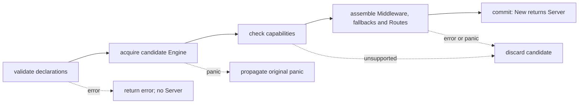
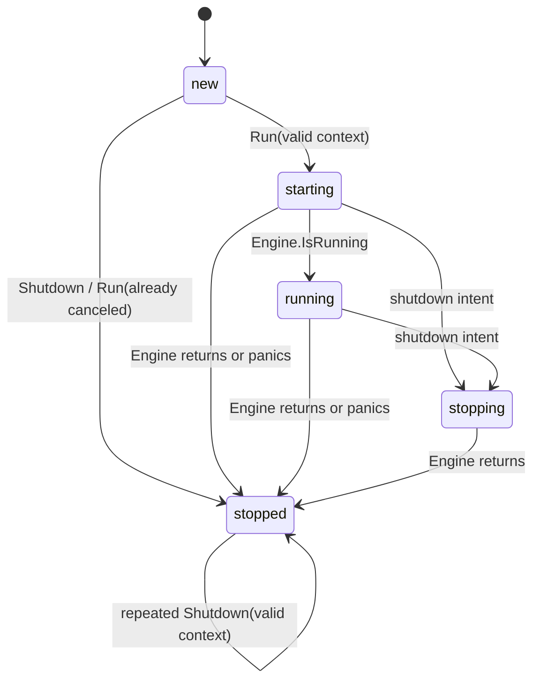

# web-hertz 架构设计

本文描述 `web-hertz` 当前实现的边界、构造流水线、状态机、并发关闭和错误不变量。任务型用法见 [web-hertz 使用指南](../guides/web-hertz-usage.md)，模块入口见 [web-hertz README](../../web-hertz/README.md)。

## 1. 要解决的问题

根 `web.Server` 只承诺单运行周期的 `Run/Shutdown`，而 Hertz 原生入口还包含 `Run`、`Spin`、`Shutdown`、`Close`、全局 hlog、原生 Router 和大量构造 Option。provider 需要把生命周期差异收敛为稳定合同，同时不复制 Hertz 编程模型。

### 设计目标

1. 封装一个 `*server.Hertz`，实现根 `web.Server`。
2. 使用 context 驱动运行和优雅停止，不接管进程信号。
3. 独立拥有 Hertz typed Config、默认值和校验。
4. 保留 Hertz 原生 Option、Middleware、NoRoute/NoMethod 和 Router 扩展能力。
5. 提供不依赖具体后端的请求完成态快照与窄 Observer fan-out。
6. 并发 Run/Shutdown 结果确定，错误保留稳定 code 和底层 cause。
7. 生命周期日志使用当前 `hlog.SystemLogger()`，不隐式修改全局 Logger。

### 非目标

1. 不抽象跨框架 Router、Handler、Context、Middleware、Controller 或 Filter。
2. 不读取 config.Manager、YAML、环境变量或固定 scope。
3. 不管理 IOC、Controller 扫描、字段注入或应用模块发现。
4. 不安装 recovery、CORS、gzip、request-id、access-log 等默认 Middleware；完成态 Observation 也只有显式 Observer 时安装。
5. 不管理 OS signal、Hertz Registry、Nacos/Consul Client 或凭据。
6. 不创建 Zap Logger，也不调用 `hlog.SetLogger`。
7. 不暴露可以绕过状态机的原生 Run/Spin/Shutdown/Close 入口。

## 2. 核心设计决策

### 2.1 封装 Engine，只统一运行合同

约束是应用需要统一编排 Web 工作负载，但 Hertz 原生 Engine 同时暴露 `Run/Spin/Shutdown/Close`，任一入口都能绕过 provider 状态机。当前选择由 `Server` 独占 `*server.Hertz`，只通过根 `web.Server` 暴露 `Run/Shutdown`；Hertz 专属构造能力留在本模块 Option。

实现上，Engine 在 `New` 内创建且没有 getter。对外结果是单运行周期、共享停止和错误归一化可以成立；代价是必须取得 Engine 的扩展不能直接接入。未选择直接返回 Engine，也不预先增加通用 Configurer；只有 Option 和 RouteFunc 无法表达真实能力时，才评估更窄入口。

### 2.2 保留 Hertz RouterGroup，不抽象跨框架 Router

约束是 Hertz Context、Handler 链、Group 和路径参数都有框架语义，同时 RouteFunc 不能取得 Engine 生命周期入口。当前选择把一个生命周期隔离的根 `*route.RouterGroup` 交给全部 RouteFunc，而不是定义最小公分母 Router，也不是传递动态类型可能为 `*server.Hertz` 的 `route.IRouter`。

实现上，provider 在全局 Middleware 注册后创建共享 `Group("/")`。调用方仍可直接使用 GET/POST/Group/Use，且不能断言为 Engine。代价是共享 group 上的 `Use` 等修改会影响后续 RouteFunc；需要隔离时由调用方显式创建子 Group。未选择跨框架 Router，因为它会复制 Hertz 编程模型并形成长期生态适配成本。

### 2.3 使用 Run 而不是 Spin

约束是 OS signal 和多工作负载退出顺序必须归应用宿主统一管理，而 Hertz `Spin` 会自行等待 signal，并通过私有 OnRun hook 执行 Registry 注册。当前选择调用 `Run`，由调用方把 signal 转换为 context。

对外结果是 provider 不接管 signal，能够嵌入统一 Runner；代价是不能声称支持 `Spin` 私有 Registry 生命周期。因此最终 Hertz Options 一旦包含 Registry 就 fail-fast。未选择透传 Registry，因为那会造成启动未注册、停止却注销的不对称行为。

### 2.4 分离 caller deadline 与共享停止预算

约束是并发 Shutdown 调用者可能具有不同 deadline，但底层优雅停止只能执行一次。当前选择让每个 caller context 只限制当前等待，底层 driver 使用 `context.Background()` 调用 Hertz，由最终 `ExitWaitTime` 约束 hook、连接排空和 transport 停止。

对外结果是最短 caller deadline 不会污染其他调用者的共享结果；等待中断错误保留原 `shutdown.failed` code，并通过 `ErrShutdownWaitInterrupted` 提供独立 `errors.Is` 分支。代价是 caller timeout 后底层停止仍会继续，context 不能强制终止 driver。未选择只比较 `context.Canceled/DeadlineExceeded`，因为底层停止失败可能携带相同 cause；也未把首个 caller context 传给 Hertz，因为调用顺序会意外决定全局停止预算。

### 2.5 Controller/Filter 留在应用装配层

约束是纯 Hertz provider 不需要 IOC、配置 scope、方法扫描或日志安装。当前选择只接受原生 Middleware 和 RouteFunc，把 Controller/Filter 聚合留给 `app-web-hertz`。

对外结果是 provider 可独立使用，依赖方向保持单向；代价是 IOC 应用需要额外装配模块。未选择把应用组织概念下沉到 provider，因为那会把稳定运行适配与易变化的应用约定耦合。

## 3. 依赖与所有权

```text
application composition root
  ├─ calls/borrows ──> web-hertz ──owns──> Hertz Engine
  │                           └─implements──> web.Server
  ├─ owns/shared ───> hlog logger（可选）
  └─ owns ──────────> OS signal；按调用借出 context
```

图中的 `calls/borrows` 表示调用和临时借用，`owns` 表示最终释放责任，`implements` 表示接口实现而非所有权转移。`web-hertz` 创建并独占一个 Hertz Engine；调用方拥有输入声明、进程 signal 和 hlog 安装策略；provider 拥有 Engine 运行周期及共享停止事务。

模块依赖 `web`、`errcode` 和 Hertz，不依赖 `app`、`app-runtime`、IOC、根日志或具体配置 provider。代码中的 `app.HandlerFunc` 是 Hertz 类型。

| 资源 | 所有权 | 成功后的释放 | 构造失败语义 |
|---|---|---|---|
| `*server.Hertz`、生命周期状态和完成信号 | provider owned | `Server.Run/Shutdown` 收敛 | 候选 Engine 不发布，由 provider 丢弃 |
| `Config`、web-hertz Option 声明 | caller owned，构造期 borrowed | 不需要释放 | 调用方可修正后重新构造 |
| `Run/Shutdown` context | caller owned，单次调用 borrowed | 调用返回后不再持有 | nil 或已取消按生命周期合同处理 |
| Hertz hlog | process shared、上层 owned | 上层在 Server 完整停止后恢复/关闭后端 | provider 从不安装、恢复或关闭 |
| Listener、Transport 等原生 Option 携带资源 | 遵循对应 Hertz Option 合同 | Server 提交后由 Hertz 运行语义决定 | provider 不做通用回滚；调用方仍负责独立创建且未转移的资源 |
| RouteFunc 自身产生的外部副作用 | caller owned | 由 RouteFunc 所属上层管理 | 后续 RouteFunc 失败时 provider 无法回滚 |

## 4. 核心对象

| 对象 | 责任 |
|---|---|
| `Config` | 定义 provider 自有 typed 配置和零值规则 |
| `RouterConfig` | 使用 optional bool 表达未配置、显式开启和显式关闭 |
| `Option` | 分类聚合 Hertz Option、Middleware、NoRoute/NoMethod、RouteFunc |
| `RouteFunc` | 在构造事务中使用生命周期隔离的根 `*route.RouterGroup` 注册路由 |
| `HTTPRequestObservation` / `RequestObserver` | 完成态值快照、开始通知和同步消费合同 |
| `Server` | 独占 Engine，协调单运行周期和共享停止结果 |
| `lifecycleState` | 表达 new/starting/running/stopping/stopped 内部阶段 |

`Server` 不提供 `Engine()`。需要路由能力时使用 RouteFunc，需要构造能力时使用 Hertz Option；这两个入口覆盖后仍有真实扩展缺口时，才评估更窄的受控 Configurer。

## 5. 构造事务

`New` 是一个只在成功返回时提交的构造事务：



实线箭头表示候选对象的构造推进，虚线表示当前阶段的失败出口；只有 `New` 成功返回才把候选 Engine 所有权转移给 Server。`discard candidate` 只丢弃 provider 内未发布的候选对象，不代表能够回滚原生 Option 或 RouteFunc 已经产生的外部副作用。

| 阶段 | 输入与前置条件 | 主要动作 | 资源与状态 | 失败结果 | 成功输出 |
|---|---|---|---|---|---|
| validate | typed Config、web-hertz Options | 默认值/负值校验，分类 Hertz Options、Middleware、RouteFunc | 无 Engine | 稳定配置或声明 error | 已归一化构造计划 |
| acquire | 有效计划 | typed Config 先映射，原生 Hertz Options 后应用；声明 NoMethod 时最终开启 405，调用 `server.New` | 未发布的候选 Engine | 原生 Option panic 原样传播 | 最终 Hertz Options |
| capability | 候选 Engine | 按最终 Options 拒绝 Registry | Engine 尚未运行 | `registry.unsupported` | 可装配 Engine |
| assemble | 可装配 Engine | 先 `Use` 全局 Middleware，再安装 NoRoute/NoMethod，最后创建共享根 `Group("/")` 并顺序执行 RouteFunc | fallback 与路由只存在于候选 Engine | RouteFunc error 或带阶段的 panic | 冻结的候选 Server |
| commit | 全部阶段成功 | 构造生命周期状态和完成信号，返回 `*Server` | Engine 所有权转移给 Server | 无提交后构造分支 | `new` 状态 Server |

唯一 commit point 是 `New` 成功返回。提交前不会返回半初始化 Server；提交后调用方必须最终执行一次有效 `Run` 或 `Shutdown` 来消费单运行周期。分类聚合保证调用方即使交错声明各类 Option，最终也总是先冻结全局 Middleware，再安装 fallback，最后注册路由。

Hertz 路由冲突等 panic 是编程错误。构造边界只为 RouteFunc/Hertz 路由 panic 增加 `stage=register_routes` 和原始 cause；原生 Hertz Option 在 `server.New` 内发生的 panic 不经过该边界，会原样传播。provider 不尝试恢复调用方 Option 或 RouteFunc 已执行的外部副作用。

构造失败矩阵：

| 阶段/原因 | 对外结果 | 对象状态 | 回滚或清理 | 能否重试 |
|---|---|---|---|---|
| Config、web-hertz Option 或 nil 原生声明非法 | 稳定 error | 未构建 | 无 provider 资源；调用方保持输入所有权 | 修正输入后可重新 `New` |
| 非 nil 原生 Hertz Option 自身 panic | 原始 panic | 未提交；Engine 可能尚未完成创建 | provider 无通用回滚；调用方处理 Option 已产生的副作用 | 仅在修复 Option 并确认外部状态后重试 |
| 最终 Registry 能力不受支持 | `web_hertz.registry.unsupported` | 候选 Engine 未运行且未提交 | provider 丢弃候选；未启动 goroutine、注册或注销；外部注入资源仍按调用方/Hertz 合同处理 | 移除 Registry 后可重建 |
| RouteFunc 显式返回 error | `web_hertz.route.register_failed`，保留 cause | 候选 Engine 与此前路由未提交 | provider 丢弃候选；RouteFunc 外部副作用不回滚 | 根据 cause 清理后可重建 |
| Hertz 路由或 RouteFunc panic | 添加 `stage=register_routes` 后继续 panic | 同上 | 不吞掉编程错误；外部副作用不回滚 | 修复确定性缺陷后重建，不应原样重试 |
| 全部阶段成功 | 返回 `new` Server | 已提交、配置和路由冻结 | Server 接管 Engine 单运行周期 | 不复用当前对象重建 |

## 6. 配置模型

`Config` 只表示稳定、高频、直接映射 Server/Router 的字段：address、read timeout、idle timeout、body size、header size、exit wait time，以及 Router 的路径修正、405 扫描和路由打印开关。默认值由本模块固定，不因 Hertz 小版本升级静默变化；具体数值以 [web-hertz README](../../web-hertz/README.md) 的配置表为公共权威入口。

数值零值表示使用 provider 默认值，负值表示输入错误。Router bool 使用指针表达三态：nil 使用默认值，非 nil 保留显式 true/false。高级 Hertz Option 在 typed Config 之后应用，因此可以表达 Hertz 特殊零值或未进入 typed Config 的能力。

最终优先级：

```text
provider defaults < typed Config explicit fields < native Options in declaration order
```

唯一例外是 `WithNoMethod`：声明后 provider 会在原生 Option 之后最终开启 `HandleMethodNotAllowed`，避免自定义 405 Handler 因覆盖顺序而不可达。

provider 不读取配置来源，也不承担热更新。Server 构造后配置冻结；监听地址、transport 和退出预算不能在运行期修改。

## 7. 原生扩展边界

### Middleware

`WithMiddleware` 接受 `app.HandlerFunc`，保持声明顺序。provider 不把 Handler 包装为 Filter，也不判断 recovery/access-log 等业务优先级。Middleware 的 before/after 嵌套语义完全遵循 Hertz。

`WithRequestObservers` 是完成态观测的窄例外：它在声明位置生成单个私有 Middleware，一次计时并复制 Method、模板 Route、无 query Path、最终 Status/Duration/Body 大小和有限 Outcome，再同步 fan-out。未知路由固定 `_unmatched`，非标准 Method 固定 `_other`。可选生命周期扩展只接收 Method；Metadata 扩展只能补充 Request ID、Trace ID 和 panic 标记，不能覆盖 label 维度。

### NoRoute 与 NoMethod

`WithNoRoute`、`WithNoMethod` 是 Engine fallback 的窄合同，不暴露 `*server.Hertz`。两者按声明顺序追加 Handler，并在全局 Middleware 之后安装，因此继承相同的 recovery、request-id 和请求观测链。nil Handler 在构造阶段失败；Handler 执行期 panic 仍是请求路径编程错误，由调用方显式安装的 Recovery Middleware 决定是否恢复。

`WithNoMethod` 同时表达“安装自定义 405 链”和“启用方法不允许扫描”，所以其可达语义高于通用原生 Option 覆盖。若应用只想开启 Hertz 默认 405，不声明自定义 Handler，应使用 `RouterConfig.HandleMethodNotAllowed`。

### RouteFunc

`RouteFunc func(*route.RouterGroup) error` 同时满足三个目标：

1. 调用方可以直接使用 GET/POST/Group/Use 和 Hertz 生态。
2. provider 统一传入共享根 `Group("/")`；函数拿不到 `*server.Hertz`，不能绕过生命周期入口。
3. error 为应用装配失败提供确定的构造事务边界。

Controller 是应用组织概念。`app-web-hertz` 把显式聚合的 Controller 转换为 RouteFunc，并提供受限方法名自动路由；provider 自身不通过反射推导 method/path。

### Hertz Options

`WithHertzOptions` 是构造 escape hatch。provider 只拒绝 nil Option 和最终 Registry，其他字段由 Hertz 定义。调用方使用该入口即接受 Hertz 版本语义。

Registry 被拒绝是生命周期约束，不是功能缺失的偶然限制：Hertz `Spin` 才安装私有注册 OnRun hook，而 provider 必须使用不接管 signal 的 `Run`。直接透传 Registry 会造成只注销、不注册。

## 8. 生命周期状态机



箭头表示内部生命周期状态转换，不表示 goroutine 所有权转移。nil context 不触发转换；在 starting/running/stopping/stopped 调用 `Run` 都返回 `state.invalid`。`stopped` 是终态，重复 Shutdown 只读取首次共享结果，不能迁回其他状态。

Engine 返回时会先把内部状态置为 stopped；Run 与未被 caller context 提前结束的 Shutdown 仍会等待运行观测和共享停止结果发布后再返回。因此“Engine 已退出”和“稳定结果已发布”是两个完成点，不能只依赖状态值判断释放时机。Server 不支持 restart；重新运行必须重新构造。

### Run

1. nil context 返回 `context.invalid`，状态不变。
2. context 在调用前已取消时，不进入 Hertz，直接消费运行周期并返回 nil。
3. 只有 new 可以进入 starting；并发或重复 Run 返回 `state.invalid`。
4. Engine Run 在独立 goroutine 执行，运行期 panic 转为带 cause 的 `run.failed`。
5. context 取消只触发共享停止，Run 继续等待 Engine 和停止结果全部发布。
6. Engine 自然返回或失败时，没有共享停止事务也会发布完成结果；Engine error 只进入 Run 结果。
7. 优雅停止且 Engine 返回 nil 时，Run 返回 nil；运行或停止真实失败不会被吞掉。

### Shutdown

1. nil context 返回 `context.invalid`，不触发停止。
2. new 状态直接进入 stopped，关闭共享结果；后续 Shutdown 返回同一成功结果。
3. starting/running 只有首个调用者启动 shutdown driver。
4. driver 等 Hertz `IsRunning` 后调用一次 `Engine.Shutdown(context.Background())`。
5. Hertz 内部使用最终 `ExitWaitTimeout` 创建停止预算。
6. 每个调用者只在自己的 context 与共享 `shutdownDone` 之间等待。
7. 一个调用者取消或超时返回 `shutdown.failed`，错误链包含 `ErrShutdownWaitInterrupted` 和 caller context cause；后台停止和其他调用者继续等待稳定结果。
8. driver 先输出最终停止日志，再发布 `shutdownDone`，使上层可以在稳定结果后安全恢复全局 hlog。

## 9. Shutdown driver 与 context 边界

本节说明 2.4 节设计决策的运行机制。provider 将两个预算分开：

```text
caller context     -> 只限制该调用者等待
final ExitWaitTime -> 限制 Hertz hook、连接排空和 transport Shutdown
```

因此 caller timeout 不表示底层停止已取消。后续调用者可以使用新的 context 继续等待同一个结果。

Hertz 只有在 Engine 标记 running 后才允许 Shutdown。driver 在 starting 阶段轮询 `IsRunning`；若 Engine 先失败，直接使用 Run 结果收敛。该内部状态不承诺端口已经可请求，也不是公共 readiness API。若未来第三方高级扩展在初始化阶段永久阻塞，provider 无法强制终止该 goroutine，这是 Hertz 入口能力边界。

## 10. 错误、panic 与运行失败

错误分为稳定 code、阶段消息和底层 cause：

```text
web_hertz.shutdown.failed
  message: op/result/stage/reason
  cause: context deadline / Hertz transport error
```

调用方使用 `errcode.IsCode` 分支，使用标准 `errors.Is/As` 定位 cause。日志和错误不得包含 TLS 私钥、Registry token、请求体或完整凭据。

panic 边界按阶段区分：

1. 原生 Hertz Option 或 `server.New` panic：原样传播；该阶段尚未进入 provider 路由构造边界，调用方负责 Option 已产生的外部副作用。
2. RouteFunc/Hertz 路由构造 panic：补充 `stage=register_routes` 后继续 panic，属于编程错误。
3. Hertz transport 运行期 panic：转换为 `run.failed`，满足根 `web.Server` 运行期不 panic 合同。

Hertz v0.10.5 的未运行错误 sentinel 未导出。provider 对文本 `engine is not running` 做窄归一化，并用锁定版本合同测试防止升级后静默失效。

运行失败矩阵：

| 触发/失败原因 | `Run` 可观察结果 | `Shutdown` 可观察结果 | 对象状态与清理 | 后续动作 |
|---|---|---|---|---|
| `Run(nil)` | `context.invalid` | 后续仍按 new 状态正常处理 | 保持 new，无资源启动 | 可用有效 context 重试当前 Server |
| Run 前 context 已取消 | nil | 当前及后续调用均为 nil | 直接 stopped，不建立监听 | 当前周期已消费；重新运行需重建 |
| Run 前先调用 Shutdown | 后续 Run 返回 `state.invalid` | 当前及后续调用均为 nil | 直接 stopped，不建立监听 | 重新运行需重建 |
| 并发或重复 Run | 非首个调用返回 `state.invalid` | 不受影响 | 首个仍运行时继续；已停止时保持 stopped | 不可用第二个 Run 重启 |
| 监听/transport 返回错误 | `run.failed`，保留 Engine cause | Engine 已自行结束，后续调用为 nil | stopped；没有底层 Shutdown 失败 | 排除运行原因后重建 |
| transport 运行期 panic | `run.failed`，保留 panic cause | Engine 已收敛，后续调用为 nil | stopped；panic 不突破公共运行合同 | 修复 transport 后重建 |
| context 取消且优雅停止成功 | nil | nil | Engine 和运行观测均退出，最终 stopped | 需要再次运行时重建 |
| 底层 Shutdown 失败 | `shutdown.failed`，cause 合并 Shutdown 与可能的 Engine error | 所有稳定观察者得到相同 `shutdown.failed` 和 Shutdown cause | Engine 返回后 stopped，共享结果只发布一次 | 清理底层故障后重建 |
| 单个 Shutdown caller 取消/超时 | 实际 Run 调用继续等待稳定停止结果 | 当前 caller 返回 `shutdown.failed`，同时匹配 `ErrShutdownWaitInterrupted` 和自身 context cause | 共享停止继续，caller deadline 不写入共享结果 | 可用新 context 再次等待同一 Server |

## 11. 并发与可验证不变量

### 对外不变量

| 可观察合同 | 保证机制 | 合同测试 |
|---|---|---|
| 只有首次 Run 能进入 Hertz，后续或并发 Run 返回 `state.invalid` | mutex 下原子执行 new -> starting | `TestConcurrentRunIsRejected` |
| Run 前 Shutdown 或已取消的 Run 都终结单运行周期，且不建立监听 | mutex 下直接执行 new -> stopped 并发布完成结果 | `TestShutdownBeforeRunConsumesCycle`、`TestRunWithCanceledContextConsumesCycleWithoutListening` |
| 并发 Shutdown 只触发一次底层 Shutdown，并观察同一稳定结果 | `shutdownStarted` 选举唯一 driver，`shutdownDone` 广播结果 | `TestConcurrentShutdownSharesOneResult` |
| 单个 caller timeout 只结束自己的等待，不污染共享停止，且可与底层同类 context cause 分支 | caller context 与 Background driver 分离，并在等待错误链加入 `ErrShutdownWaitInterrupted` | `TestShutdownCallerDeadlineDoesNotPoisonSharedStop`、`TestShutdownFailureIsSharedWithRun` |
| 运行期 transport panic 通过 error 返回，不突破 `web.Server` 合同 | Engine Run goroutine 内部 recover 并保留 cause | `TestRunConvertsTransportPanicToError` |
| RouteFunc 只能取得生命周期隔离的共享根 RouterGroup | 构造期创建 `Group("/")`，不传递 Engine | `TestNewPassesLifecycleIsolatedRootGroup` |
| NoRoute/NoMethod 继承全局 Middleware，且 WithNoMethod 必达 | 先安装全局 Middleware，最终开启 405 后安装 fallback | `TestWithNoRouteAppendsHandlersAndInheritsMiddleware`、`TestWithNoMethodForcesReachable405AndInheritsMiddleware` |
| fallback Handler 的 panic 不在构造期吞掉 | 请求期由 Hertz 链和显式 Recovery 决定 | `TestFallbackHandlerPanicRemainsProgrammingFailure` |
| 动态 URL 不扩张 route label，Observer panic 不破坏响应 | 模板 FullPath + 固定 unmatched + 单 Observer 隔离 | `TestRequestObservationUsesUnmatchedRouteAndIsolatesObserverPanic` |
| 原始请求 panic 保持语义且仍产生完成态 | defer 快照/通知后重新 panic | `TestRequestObservationPreservesRawPanicSemantics` |
| 底层 Shutdown 失败同时对 Run 和所有稳定 Shutdown 观察者可见 | 先缓存唯一 `shutdownErr`，再关闭共享完成信号 | `TestShutdownFailureIsSharedWithRun` |

### 内部同步机制

1. 每个成功进入生命周期的 Server 至多创建一个 Engine Run goroutine 和一个 shutdown driver；running observer 只负责状态与日志观测。
2. `engineDone`、`runningObservationDone` 和 `shutdownDone` 各关闭一次，所有生命周期状态和最终结果由同一 mutex 保护。
3. Run 在读取结果前等待 Engine 和共享停止两个完成点，避免 signal 已关闭但错误尚未发布的竞态。
4. driver 在发布 `shutdownDone` 前等待 running observer 退出并完成最终日志；稳定结果发布后 provider 不再读取 hlog，应用装配层才可恢复进程级 Logger。
5. stopped 是不可逆终态，不能迁回 new、starting 或 running。

## 12. 可观测性

provider 的生命周期日志写入 `hlog.SystemLogger()`，统一包含 `op/result`，失败或重要分支增加 `reason`：

```text
op=web_hertz.run      result=running
op=web_hertz.run      result=failed reason=lifecycle_failed
op=web_hertz.shutdown result=ok     reason=engine_stopped
op=web_hertz.shutdown result=failed reason=engine_shutdown_failed
```

稳定错误 code 和底层 cause 是调用方的主要失败观测入口；日志用于运行诊断，不替代错误分支。provider 不安装 Logger，因 hlog 是进程全局状态。纯应用可在 composition root 使用 `hlog-zap.Install`；需要安装和恢复租约时使用 `app-web-hertz`。

provider 不自动安装 access-log、指标、trace 或健康检查后端。完成态 Observer 由调用方显式提供；provider 只复制值快照，不依赖 Logger、Prometheus 或 OTel。当前也不提供 Ready、Address、Status 查询，外部探针只能基于应用显式注册的健康路由和进程编排结果判断。日志不得记录请求体、token、TLS 私钥或完整凭据。

## 13. 容量与性能边界

1. Option 分类、RouteFunc 执行和路由注册只发生在构造期，provider 自身成本随 Middleware 与 RouteFunc 数量线性增长；RouteFunc 内部工作量由调用方负责。请求路径不经过 provider 自定义反射或路由包装。
2. starting 阶段通常有两个适配层 goroutine：Engine Run 与 running observer；observer 在确认 running 或 Engine 提前返回后退出，稳定运行期只保留 Engine Run goroutine。
3. 触发停止后至多增加一个 shutdown driver；若 observer 尚未退出，适配层瞬时最多存在 Engine Run、observer、driver 三个 goroutine。共享结果只会在 Hertz Run 已返回且 observer 已退出后发布；负责发布结果的 Engine Run goroutine 或 driver 随即返回，不承诺在 channel 关闭前已经退出。
4. `IsRunning` 的 1ms 轮询只存在于 starting/stopping 生命周期窗口，不进入请求路径；若第三方初始化永久阻塞，该轮询和相关 goroutine 也无法自行收敛，这是 Hertz 入口能力边界。
5. Server 构造成功后 Config、Middleware 和 RouteFunc 声明冻结；provider 不为运行期热更新保留额外副本或同步路径。

## 14. Open Gaps / Future Improvements

1. 尚无 Ready/Address/Status 查询；没有跨 provider 需求前不扩展根接口。
2. 尚无服务注册合同；需要先定义注册、失败回滚、注销和所有权。
3. 初始化阶段永久阻塞无法被 Hertz Shutdown 中断。
4. pprof 已可通过接收 RouterGroup 的 RouteFunc 表达；配置化启用、独立管理面和可观测性扩展按
   [能力配置化与可观测性演进提案](web-hertz-capability-observability-proposal.md) 评审，不直接暴露 Engine。
5. Controller、Filter、IOC、配置绑定和 hlog 恢复由独立 `app-web-hertz` 实现，不进入本 provider。

## 15. File Map

1. `web-hertz/config.go`：独立配置、默认值和 Hertz Option 映射。
2. `web-hertz/options.go`：Hertz Option、Middleware、fallback 与 RouteFunc 构造计划。
3. `web-hertz/request_observation.go`、`request_observer*.go`：完成态 VO、窄接口、Option 与 Middleware。
4. `web-hertz/route.go`：RouteFunc 公共合同。
5. `web-hertz/no_route.go`、`web-hertz/no_method.go`：404/405 fallback 窄合同。
6. `web-hertz/server.go`：Engine 构造、Registry 校验、fallback 与路由事务。
7. `web-hertz/lifecycle.go`：状态机、共享停止和错误归一化。
8. `web-hertz/errors.go`：稳定错误码及 cause 包装。
9. `web-hertz/*_test.go`：配置、404/405、Observation、构造、真实监听、失败与并发合同测试。
10. `examples/quickstart-web-hertz/`：可运行教学示例。

## 16. 相关文档

1. [web-hertz README](../../web-hertz/README.md)
2. [web-hertz 使用指南](../guides/web-hertz-usage.md)
3. [根 web 合同](../../web/README.md)
4. [quickstart-web-hertz](../../examples/quickstart-web-hertz/README.md)
5. [app-web-hertz 架构设计](app-web-hertz-design.md)
6. [能力配置化与可观测性演进提案](web-hertz-capability-observability-proposal.md)
